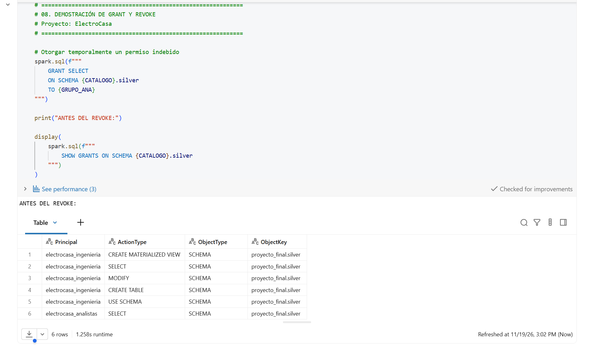

# ElectroCasa — Proyecto Final de Ingeniería de Datos

**Tecnologías:** Databricks | PySpark | Delta Lake | Unity Catalog | Azure SQL Database

**Arquitectura:** Medallion (Bronze, Silver y Gold)

### 1. Descripción del proyecto

El proyecto ElectroCasa tiene como objetivo implementar una plataforma
de ingeniería de datos utilizando Azure Databricks, Unity Catalog,
Delta Lake y una arquitectura Medallion.

La solución integra información de diferentes procesos del negocio,
incluyendo ventas, catálogo de productos, sucursales, empleados,
reseñas, devoluciones y seguimiento de envíos.

Los datos proceden de archivos y de una base de datos Azure SQL Database.

La arquitectura se organiza en tres capas:

- **Bronze:** ingesta y almacenamiento de los datos de origen.
- **Silver:** limpieza, estandarización, aplicación de contratos de datos
  y controles de calidad.
- **Gold:** construcción de modelos analíticos e indicadores de negocio.

> **Estado del proyecto:** la ingesta Bronze está implementada.
> Las capas Silver y Gold se encuentran pendientes de desarrollo.

---

## 2. Configuración inicial del entorno

### 2.1 Notebook `00_setup`

**Ubicación:** `notebooks/00_setup`

**Objetivo:** preparar la infraestructura de Unity Catalog y configurar
los permisos iniciales necesarios para ejecutar el proyecto ElectroCasa.

El notebook realiza las siguientes operaciones:

1. Verifica la existencia del catálogo `proyecto_final`.
2. Crea los esquemas de la arquitectura Medallion.
3. Crea un volumen para almacenar los archivos de origen.
4. Organiza los directorios de las fuentes de datos.
5. Verifica la pertenencia al grupo de Ingeniería.
6. Configura los permisos de los grupos del proyecto.
7. Valida los privilegios mediante consultas a Unity Catalog.

### 2.2 Configuración de Unity Catalog

La solución utiliza el catálogo:

`proyecto_final`

Dentro de este catálogo se crean tres esquemas:

| Esquema | Propósito |
|---------|-----------|
| `bronze` | Almacenamiento de datos ingeridos desde las fuentes. |
| `silver` | Depuración, estandarización y validación de datos. |
| `gold` | Modelos analíticos y métricas de negocio. |

La creación se realiza mediante instrucciones SQL idempotentes:

```sql
CREATE SCHEMA IF NOT EXISTS proyecto_final.bronze;
CREATE SCHEMA IF NOT EXISTS proyecto_final.silver;
CREATE SCHEMA IF NOT EXISTS proyecto_final.gold;
```

El uso de `IF NOT EXISTS` permite ejecutar nuevamente esta sección
sin provocar errores por la existencia previa de los esquemas.

### 2.3 Configuración del volumen de landing

Se implementa un volumen administrado de Unity Catalog:

`proyecto_final.default.vol_landing`

Su ruta es:

```text
/Volumes/proyecto_final/default/vol_landing/
```

Este volumen centraliza los archivos que se utilizarán como fuentes
de las ingestas Bronze.

La estructura es:

```text
vol_landing/
├── ventas/
├── catalogo/
├── empleados/
├── resenas/
├── devoluciones/
└── sucursales/
```

**Justificación técnica**

La utilización de un volumen administrado permite:

- Centralizar los archivos utilizados por los procesos de ingesta.
- Mantener separadas las fuentes de datos de las tablas Delta.
- Organizar los archivos por dominio de negocio.
- Administrar permisos mediante Unity Catalog.
- Facilitar la incorporación de nuevos archivos.

La fuente Azure SQL Database se integra mediante Lakeflow Connect
y no utiliza este volumen de landing.

### 2.4 Configuración de seguridad

Se implementa un modelo de control de acceso basado en grupos
mediante los privilegios de Unity Catalog.

Los grupos utilizados son:

- `electrocasa_ingenieria`
- `electrocasa_analistas`
- `electrocasa_auditoria`

Los privilegios configurados por el notebook son:

| Grupo | Bronze | Silver | Gold | Landing |
|-------|--------|--------|------|---------|
| Ingeniería | Lectura y modificación | Lectura y modificación | Lectura y modificación | Lectura y escritura |
| Analistas | Sin concesión explícita | Sin concesión explícita | Lectura | Sin concesión explícita |
| Auditoría | Sin concesión explícita | Sin concesión explícita | Lectura | Sin concesión explícita |

El grupo de Ingeniería también recibe privilegios para crear
tablas y vistas materializadas en los esquemas de la arquitectura.

Los permisos de Analistas y Auditoría se limitan en este notebook
al acceso de lectura sobre el esquema Gold.

Este diseño responde al principio de mínimo privilegio,
según el cual cada grupo recibe los permisos necesarios
para desempeñar su función.

**Nota:** la tabla refleja las concesiones realizadas por
`00_setup`, no necesariamente todos los permisos efectivos
que puedan heredarse de otras configuraciones.

### 2.5 Validación de la configuración

El notebook utiliza las siguientes operaciones de verificación:

```sql
DESCRIBE CATALOG proyecto_final;

SHOW SCHEMAS IN proyecto_final;

SHOW VOLUMES IN proyecto_final.default;

SHOW GRANTS ON CATALOG proyecto_final;

SHOW GRANTS ON SCHEMA proyecto_final.bronze;

SHOW GRANTS ON SCHEMA proyecto_final.silver;

SHOW GRANTS ON SCHEMA proyecto_final.gold;

SHOW GRANTS ON VOLUME proyecto_final.default.vol_landing;
```

Estas consultas permiten comprobar:

- La disponibilidad del catálogo.
- La existencia de los esquemas Medallion.
- La creación del volumen.
- Los privilegios concedidos sobre los objetos.

### 2.6 Requisitos previos para el despliegue

Antes de ejecutar `00_setup`, se requiere:

1. Un workspace de Databricks con Unity Catalog habilitado.
2. La existencia del catálogo `proyecto_final`.
3. Los grupos de cuenta:
   - `electrocasa_ingenieria`
   - `electrocasa_analistas`
   - `electrocasa_auditoria`
4. Una identidad con privilegios suficientes para crear
   esquemas y volúmenes, así como para conceder permisos.

El catálogo y los grupos deben prepararse previamente,
ya que el notebook verifica su existencia, pero no los crea.

### 2.7 Evidencias de ejecución

Las evidencias de la configuración inicial se almacenarán en
`evidencias/setup/`.

Se incluirán capturas de:

- La estructura del catálogo y sus esquemas.
- La creación del volumen de landing.
- Los directorios correspondientes a las seis fuentes.
- La verificación de permisos en Unity Catalog.

---

## 3. Demostración de seguridad: GRANT y REVOKE

### 3.1 Objetivo

**Notebook:** `notebooks/01_demo_permisos`

Se implementó una demostración controlada de administración
de privilegios mediante Unity Catalog.

El objetivo consiste en comprobar que es posible conceder,
auditar y revocar permisos sobre los objetos de datos,
aplicando el principio de mínimo privilegio.

Para esta demostración se utiliza el grupo:

`electrocasa_analistas`

Y el esquema:

`proyecto_final.silver`

De acuerdo con el modelo de seguridad de ElectroCasa,
los analistas deben acceder a los datos preparados en
la capa Gold, sin requerir acceso directo a Silver.

### 3.2 Concesión temporal de permisos: GRANT

Para demostrar la administración de privilegios,
se otorgó temporalmente el permiso `SELECT`
sobre el esquema Silver.

```sql
GRANT SELECT
ON SCHEMA proyecto_final.silver
TO `electrocasa_analistas`;
```

Esta instrucción concede al grupo de analistas
privilegios de lectura sobre las tablas y vistas
correspondientes al esquema, sujetos a los permisos
adicionales necesarios para acceder a los objetos.

El permiso se concedió exclusivamente como parte
de una prueba de seguridad.

### 3.3 Verificación de permisos concedidos

Después de ejecutar `GRANT`, se consultaron
los privilegios del esquema mediante:

```sql
SHOW GRANTS ON SCHEMA proyecto_final.silver;
```

La consulta permite identificar los privilegios
concedidos directamente sobre el esquema.

**Evidencia: estado anterior al REVOKE**

La captura correspondiente muestra el privilegio
`SELECT` concedido temporalmente al grupo
`electrocasa_analistas`.

### 3.4 Revocación de permisos: REVOKE

Una vez realizada la verificación, se retiró
el permiso temporal mediante:

```sql
REVOKE SELECT
ON SCHEMA proyecto_final.silver
FROM `electrocasa_analistas`;
```

Esta operación elimina la concesión directa
realizada durante la demostración.

La revocación permite restablecer la configuración
definida en el modelo de seguridad del proyecto.

### 3.5 Validación posterior al REVOKE

Se ejecutó nuevamente la consulta:

```sql
SHOW GRANTS ON SCHEMA proyecto_final.silver;
```

La verificación permite comprobar que el privilegio
`SELECT` concedido directamente al grupo
`electrocasa_analistas` ya no aparece.

**Evidencia: estado posterior al REVOKE**

La captura correspondiente muestra la eliminación
de la concesión temporal.

Esta comprobación demuestra la revocación del permiso
directo. No constituye por sí sola una prueba de que
el usuario carezca de cualquier otro acceso heredado.

### 3.6 Justificación técnica

La demostración de GRANT y REVOKE permite verificar
la administración de privilegios en Unity Catalog.

El modelo implementado distingue tres responsabilidades:

| Grupo | Responsabilidad |
|-------|-----------------|
| Ingeniería | Preparar, transformar y administrar datos. |
| Analistas | Consultar información preparada en Gold. |
| Auditoría | Consultar información autorizada para revisión y control. |

La demostración evidencia los siguientes principios:

- Control de acceso basado en grupos.
- Separación de responsabilidades.
- Administración centralizada de privilegios.
- Aplicación del principio de mínimo privilegio.
- Verificación de concesiones mediante `SHOW GRANTS`.

**Resultado:** el permiso temporal sobre Silver fue
revocado y la configuración quedó alineada con
el modelo de acceso previsto para los analistas.

La protección de columnas sensibles mediante
enmascaramiento y etiquetas se abordará
posteriormente en la implementación de Silver.

### 3.7 Evidencias de ejecución

A continuación, se presentan las evidencias de la demostración
de administración de permisos mediante Unity Catalog.

#### Evidencia 1: Permisos antes del REVOKE

Se otorgó temporalmente el privilegio SELECT al grupo
`electrocasa_analistas` sobre el esquema `proyecto_final.silver`.

La consulta SHOW GRANTS permite verificar la concesión.



#### Evidencia 2: Permisos después del REVOKE

Se ejecutó REVOKE SELECT para retirar el privilegio
concedido temporalmente al grupo de Analistas.

La siguiente evidencia muestra el resultado de SHOW GRANTS
después de realizar la revocación.


### 3.8 Conclusión

La demostración permite verificar que Unity Catalog
admite la concesión y revocación controlada de permisos.

En ElectroCasa, esta funcionalidad contribuye
a separar las responsabilidades de Ingeniería,
Analistas y Auditoría, reduciendo el riesgo de
accesos no autorizados a las diferentes capas
de la arquitectura Medallion.

## 4. Capa Bronze: ingesta de datos

*Pendiente de documentación detallada de las seis fuentes
de archivos y del pipeline de Azure SQL Database.*

---

## 5. Capa Silver

*Pendiente de implementación y documentación.*

---

## 6. Capa Gold

*Pendiente de implementación y documentación.*

---

## 7. Despliegue y automatización

*Pendiente de completar la configuración de Databricks
Declarative Automation Bundles y los recursos del proyecto.*
