# ElectroCasa — Proyecto Final de Ingeniería de Datos

**Tecnologías:** Databricks | PySpark | Delta Lake | Unity Catalog | Azure SQL Database

**Arquitectura:** Medallion (Bronze, Silver y Gold)

### 1. Descripción del proyecto

El proyecto ElectroCasa tiene como objetivo implementar una plataforma
de ingeniería de datos utilizando Azure Databricks, Unity Catalog,
Delta Lake y una arquitectura Medallion.

La solución integra información de diferentes procesos del negocio,
incluyendo ventas, catálogo de productos, sucursales, empleados,
reseñas, devoluciones y seguimiento de envíos.

Los datos proceden de archivos y de una base de datos Azure SQL Database.

La arquitectura se organiza en tres capas:

- **Bronze:** ingesta y almacenamiento de los datos de origen.
- **Silver:** limpieza, estandarización, aplicación de contratos de datos
  y controles de calidad.
- **Gold:** construcción de modelos analíticos e indicadores de negocio.

> **Estado del proyecto (21/11/2026):** las siete fuentes Silver y los **10 modelos analíticos Gold** están construidos y validados. **Se han respondido las seis preguntas de negocio del proyecto** con consultas SQL y evidencias de ejecución. Están pendientes la orquestación declarativa, las pruebas de enmascaramiento por grupo y el despliegue automatizado. Bronze y Silver están documentados en las secciones anteriores; Gold se presenta en la sección 6.

---

## 2. Configuración inicial del entorno

### 2.1 Notebook `00_setup`

**Ubicación:** `notebooks/00_setup`

**Objetivo:** preparar la infraestructura de Unity Catalog y configurar
los permisos iniciales necesarios para ejecutar el proyecto ElectroCasa.

El notebook realiza las siguientes operaciones:

1. Verifica la existencia del catálogo `proyecto_final`.
2. Crea los esquemas de la arquitectura Medallion.
3. Crea un volumen para almacenar los archivos de origen.
4. Organiza los directorios de las fuentes de datos.
5. Verifica la pertenencia al grupo de Ingeniería.
6. Configura los permisos de los grupos del proyecto.
7. Valida los privilegios mediante consultas a Unity Catalog.

### 2.2 Configuración de Unity Catalog

La solución utiliza el catálogo:

`proyecto_final`

Dentro de este catálogo se crean tres esquemas:

| Esquema | Propósito |
|---------|-----------|
| `bronze` | Almacenamiento de datos ingeridos desde las fuentes. |
| `silver` | Depuración, estandarización y validación de datos. |
| `gold` | Modelos analíticos y métricas de negocio. |

La creación se realiza mediante instrucciones SQL idempotentes:

```sql
CREATE SCHEMA IF NOT EXISTS proyecto_final.bronze;
CREATE SCHEMA IF NOT EXISTS proyecto_final.silver;
CREATE SCHEMA IF NOT EXISTS proyecto_final.gold;
```

El uso de `IF NOT EXISTS` permite ejecutar nuevamente esta sección
sin provocar errores por la existencia previa de los esquemas.

### 2.3 Configuración del volumen de landing

Se implementa un volumen administrado de Unity Catalog:

`proyecto_final.default.vol_landing`

Su ruta es:

```text
/Volumes/proyecto_final/default/vol_landing/
```

Este volumen centraliza los archivos que se utilizarán como fuentes
de las ingestas Bronze.

La estructura es:

```text
vol_landing/
├── ventas/
├── catalogo/
├── empleados/
├── resenas/
├── devoluciones/
└── sucursales/
```

**Justificación técnica**

La utilización de un volumen administrado permite:

- Centralizar los archivos utilizados por los procesos de ingesta.
- Mantener separadas las fuentes de datos de las tablas Delta.
- Organizar los archivos por dominio de negocio.
- Administrar permisos mediante Unity Catalog.
- Facilitar la incorporación de nuevos archivos.

La fuente Azure SQL Database se integra mediante Lakeflow Connect
y no utiliza este volumen de landing.

### 2.4 Configuración de seguridad

Se implementa un modelo de control de acceso basado en grupos
mediante los privilegios de Unity Catalog.

Los grupos utilizados son:

- `electrocasa_ingenieria`
- `electrocasa_analistas`
- `electrocasa_auditoria`

Los privilegios configurados por el notebook son:

| Grupo | Bronze | Silver | Gold | Landing |
|-------|--------|--------|------|---------|
| Ingeniería | Lectura y modificación | Lectura y modificación | Lectura y modificación | Lectura y escritura |
| Analistas | Sin concesión explícita | Sin concesión explícita | Lectura | Sin concesión explícita |
| Auditoría | Sin concesión explícita | Sin concesión explícita | Lectura | Sin concesión explícita |

El grupo de Ingeniería también recibe privilegios para crear
tablas y vistas materializadas en los esquemas de la arquitectura.

Los permisos de Analistas y Auditoría se limitan en este notebook
al acceso de lectura sobre el esquema Gold.

Este diseño responde al principio de mínimo privilegio,
según el cual cada grupo recibe los permisos necesarios
para desempeñar su función.

**Nota:** la tabla refleja las concesiones realizadas por
`00_setup`, no necesariamente todos los permisos efectivos
que puedan heredarse de otras configuraciones.

### 2.5 Validación de la configuración

El notebook utiliza las siguientes operaciones de verificación:

```sql
DESCRIBE CATALOG proyecto_final;

SHOW SCHEMAS IN proyecto_final;

SHOW VOLUMES IN proyecto_final.default;

SHOW GRANTS ON CATALOG proyecto_final;

SHOW GRANTS ON SCHEMA proyecto_final.bronze;

SHOW GRANTS ON SCHEMA proyecto_final.silver;

SHOW GRANTS ON SCHEMA proyecto_final.gold;

SHOW GRANTS ON VOLUME proyecto_final.default.vol_landing;
```

Estas consultas permiten comprobar:

- La disponibilidad del catálogo.
- La existencia de los esquemas Medallion.
- La creación del volumen.
- Los privilegios concedidos sobre los objetos.

### 2.6 Requisitos previos para el despliegue

Antes de ejecutar `00_setup`, se requiere:

1. Un workspace de Databricks con Unity Catalog habilitado.
2. La existencia del catálogo `proyecto_final`.
3. Los grupos de cuenta:
   - `electrocasa_ingenieria`
   - `electrocasa_analistas`
   - `electrocasa_auditoria`
4. Una identidad con privilegios suficientes para crear
   esquemas y volúmenes, así como para conceder permisos.

El catálogo y los grupos deben prepararse previamente,
ya que el notebook verifica su existencia, pero no los crea.

### 2.7 Evidencias de ejecución

Las evidencias de la configuración inicial se almacenarán en
`evidencias/setup/`.

Se incluirán capturas de:

- La estructura del catálogo y sus esquemas.
- La creación del volumen de landing.
- Los directorios correspondientes a las seis fuentes.
- La verificación de permisos en Unity Catalog.

---

## 3. Demostración de seguridad: GRANT y REVOKE

### 3.1 Objetivo

**Notebook:** `notebooks/01_demo_permisos`

Se implementó una demostración controlada de administración
de privilegios mediante Unity Catalog.

El objetivo consiste en comprobar que es posible conceder,
auditar y revocar permisos sobre los objetos de datos,
aplicando el principio de mínimo privilegio.

Para esta demostración se utiliza el grupo:

`electrocasa_analistas`

Y el esquema:

`proyecto_final.silver`

De acuerdo con el modelo de seguridad de ElectroCasa,
los analistas deben acceder a los datos preparados en
la capa Gold, sin requerir acceso directo a Silver.

### 3.2 Concesión temporal de permisos: GRANT

Para demostrar la administración de privilegios,
se otorgó temporalmente el permiso `SELECT`
sobre el esquema Silver.

```sql
GRANT SELECT
ON SCHEMA proyecto_final.silver
TO `electrocasa_analistas`;
```

Esta instrucción concede al grupo de analistas
privilegios de lectura sobre las tablas y vistas
correspondientes al esquema, sujetos a los permisos
adicionales necesarios para acceder a los objetos.

El permiso se concedió exclusivamente como parte
de una prueba de seguridad.

### 3.3 Verificación de permisos concedidos

Después de ejecutar `GRANT`, se consultaron
los privilegios del esquema mediante:

```sql
SHOW GRANTS ON SCHEMA proyecto_final.silver;
```

La consulta permite identificar los privilegios
concedidos directamente sobre el esquema.

**Evidencia: estado anterior al REVOKE**

La captura correspondiente muestra el privilegio
`SELECT` concedido temporalmente al grupo
`electrocasa_analistas`.

### 3.4 Revocación de permisos: REVOKE

Una vez realizada la verificación, se retiró
el permiso temporal mediante:

```sql
REVOKE SELECT
ON SCHEMA proyecto_final.silver
FROM `electrocasa_analistas`;
```

Esta operación elimina la concesión directa
realizada durante la demostración.

La revocación permite restablecer la configuración
definida en el modelo de seguridad del proyecto.

### 3.5 Validación posterior al REVOKE

Se ejecutó nuevamente la consulta:

```sql
SHOW GRANTS ON SCHEMA proyecto_final.silver;
```

La verificación permite comprobar que el privilegio
`SELECT` concedido directamente al grupo
`electrocasa_analistas` ya no aparece.

**Evidencia: estado posterior al REVOKE**

La captura correspondiente muestra la eliminación
de la concesión temporal.

Esta comprobación demuestra la revocación del permiso
directo. No constituye por sí sola una prueba de que
el usuario carezca de cualquier otro acceso heredado.

### 3.6 Justificación técnica

La demostración de GRANT y REVOKE permite verificar
la administración de privilegios en Unity Catalog.

El modelo implementado distingue tres responsabilidades:

| Grupo | Responsabilidad |
|-------|-----------------|
| Ingeniería | Preparar, transformar y administrar datos. |
| Analistas | Consultar información preparada en Gold. |
| Auditoría | Consultar información autorizada para revisión y control. |

La demostración evidencia los siguientes principios:

- Control de acceso basado en grupos.
- Separación de responsabilidades.
- Administración centralizada de privilegios.
- Aplicación del principio de mínimo privilegio.
- Verificación de concesiones mediante `SHOW GRANTS`.

**Resultado:** el permiso temporal sobre Silver fue
revocado y la configuración quedó alineada con
el modelo de acceso previsto para los analistas.

La protección de columnas sensibles mediante
enmascaramiento y etiquetas se abordará
posteriormente en la implementación de Silver.

### 3.7 Evidencias de ejecución

A continuación, se presentan las evidencias de la demostración
de administración de permisos mediante Unity Catalog.

#### Evidencia 1: Permisos antes del REVOKE

Se otorgó temporalmente el privilegio SELECT al grupo
`electrocasa_analistas` sobre el esquema `proyecto_final.silver`.

La consulta SHOW GRANTS permite verificar la concesión.


#### Evidencia 2: Permisos después del REVOKE

Se ejecutó REVOKE SELECT para retirar el privilegio
concedido temporalmente al grupo de Analistas.

La siguiente evidencia muestra el resultado de SHOW GRANTS
después de realizar la revocación.

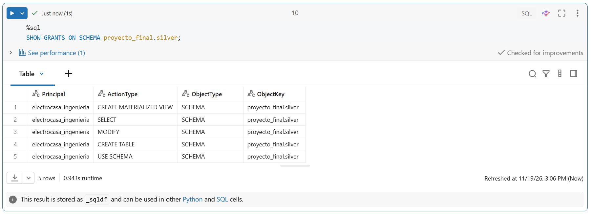

### 3.8 Conclusión

La demostración permite verificar que Unity Catalog
admite la concesión y revocación controlada de permisos.

En ElectroCasa, esta funcionalidad contribuye
a separar las responsabilidades de Ingeniería,
Analistas y Auditoría, reduciendo el riesgo de
accesos no autorizados a las diferentes capas
de la arquitectura Medallion.

## 4. Capa Bronze: ingesta de datos

### 4.1 Objetivo de la capa Bronze

La capa Bronze constituye el primer nivel de almacenamiento
de la arquitectura Medallion implementada para ElectroCasa.

Su objetivo es incorporar los datos procedentes de diferentes
fuentes, conservando su estructura original y agregando
información de trazabilidad cuando corresponda.

Las fuentes utilizadas incluyen archivos CSV y una base
de datos Azure SQL Database.

Las tecnologías de ingesta seleccionadas son:

- Auto Loader.
- COPY INTO.
- Lakeflow Connect.

La selección depende del comportamiento de cada fuente,
su frecuencia de actualización y los requisitos de
procesamiento incremental.

Las transformaciones de limpieza, estandarización y
validación de reglas de negocio se realizarán en Silver.

---

### 4.2 Ingesta de ventas mediante Auto Loader

#### 4.2.1 Descripción de la fuente

**Notebook:** `notebooks/02_bronze_ventas`

**Origen:** archivos CSV almacenados en Unity Catalog Volumes.

**Directorio de entrada:**

```text
/Volumes/proyecto_final/default/vol_landing/ventas/
```

**Tabla de destino:**

```text
proyecto_final.bronze.ventas
```

La fuente contiene información relacionada con
las operaciones comerciales de ElectroCasa.

Entre sus atributos se encuentran:

| Campo | Descripción |
|-------|-------------|
| venta_id | Identificador de la venta. |
| sucursal_id | Identificador de la sucursal. |
| producto_id | Identificador del producto. |
| vendedor_id | Identificador del vendedor. |
| cantidad | Cantidad vendida. |
| monto_total | Importe total de la venta. |
| metodo_pago | Medio de pago utilizado. |
| fecha_venta | Fecha de la operación. |
| canal | Canal comercial. |

En Bronze, estos campos se conservan inicialmente
como STRING para evitar conversiones prematuras.

#### 4.2.2 Tecnología seleccionada: Auto Loader

Se utiliza Auto Loader de Databricks para implementar
la ingesta incremental de archivos CSV.

La lectura se realiza mediante:

```python
df_stream = (
    spark.readStream
    .format("cloudFiles")
    .option("cloudFiles.format", "csv")
    .option("header", "true")
    .option("sep", ",")
    .schema(esquema_ventas)
    .load(RUTA_ORIGEN)
)
```

Auto Loader permite incorporar archivos nuevos
manteniendo el estado de procesamiento.

Para controlar este estado se utiliza el checkpoint:

```text
/Volumes/proyecto_final/default/vol_landing/_checkpoints/ventas
```

#### 4.2.3 Justificación de Auto Loader frente a COPY INTO

Se seleccionó Auto Loader debido a que la fuente
de ventas se recibe en múltiples lotes de archivos.

La solución requiere procesar nuevas entregas
sin volver a ingerir archivos ya procesados.

Auto Loader proporciona las siguientes ventajas:

1. Seguimiento de los archivos procesados.
2. Persistencia del estado mediante checkpoints.
3. Procesamiento incremental de nuevas entregas.
4. Integración con Structured Streaming y Delta Lake.
5. Posibilidad de automatizar futuras ejecuciones.

Aunque COPY INTO también permite controlar archivos
previamente cargados, Auto Loader se seleccionó
para implementar y demostrar una estrategia de
ingesta incremental basada en streaming.

En ElectroCasa se utiliza:

```python
.trigger(availableNow=True)
```

Esta configuración procesa los archivos disponibles
y finaliza la ejecución al completar el trabajo.

Por tanto, no es necesario mantener una ejecución
continua para procesar los lotes de ventas.

#### 4.2.4 Incorporación de metadatos de auditoría

Durante la ingesta se agregan dos columnas:

```python
df_bronze = (
    df_stream
    .withColumn(
        "archivo_origen",
        col("_metadata.file_name")
    )
    .withColumn(
        "fecha_ingesta",
        current_timestamp()
    )
)
```

**archivo_origen**

Permite identificar el archivo CSV desde el cual
se incorporó cada registro.

**fecha_ingesta**

Registra la fecha y hora de incorporación del dato.

Estos metadatos permiten realizar controles de
trazabilidad y auditoría de las cargas.

#### 4.2.5 Escritura en Delta Lake

La información se almacena mediante:

```python
query = (
    df_bronze.writeStream
    .format("delta")
    .outputMode("append")
    .option("checkpointLocation", RUTA_CHECKPOINT)
    .trigger(availableNow=True)
    .toTable(TABLA_DESTINO)
)

query.awaitTermination()
```

La escritura utiliza el formato Delta Lake.

El modo append incorpora nuevos registros sin
reemplazar los datos existentes.

El checkpoint permite conservar el progreso
de la ingesta entre ejecuciones.

#### 4.2.6 Prueba de ingesta incremental

Para validar el funcionamiento del mecanismo
se realizaron tres cargas sucesivas de archivos.

**Primera ejecución: lote 01**

Se incorporó el primer archivo CSV al directorio
de landing y se ejecutó el notebook.

La ejecución permitió crear y poblar la tabla
Bronze con los registros del primer lote.

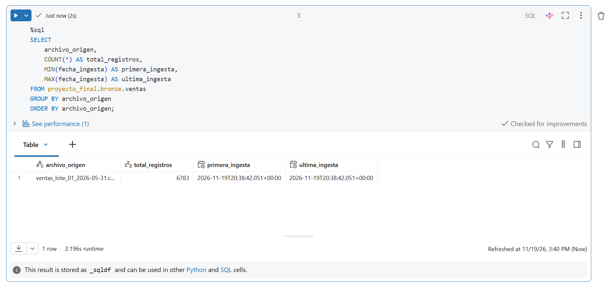

**Segunda ejecución: lote 02**

Se incorporó un segundo archivo y se ejecutó
nuevamente el proceso.

El objetivo fue comprobar que Auto Loader
identificara los nuevos archivos sin volver
a procesar los ya registrados en el checkpoint.

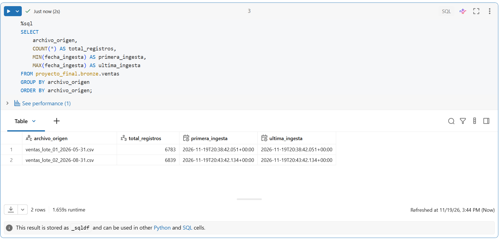

**Tercera ejecución: lote 03**

Se incorporó un tercer archivo CSV y se volvió
a ejecutar el flujo incremental.

Esta ejecución permitió validar el comportamiento
del proceso ante nuevas entregas de información.

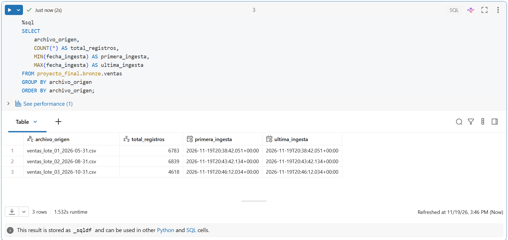

#### 4.2.7 Validación de los registros

Para revisar las cargas por archivo se utiliza:

```sql
SELECT
    archivo_origen,
    COUNT(*) AS total_registros,
    MIN(fecha_ingesta) AS primera_ingesta,
    MAX(fecha_ingesta) AS ultima_ingesta
FROM proyecto_final.bronze.ventas
GROUP BY archivo_origen
ORDER BY archivo_origen;
```

Esta consulta permite:

- Identificar los archivos incorporados.
- Contabilizar los registros de cada archivo.
- Consultar las fechas de ingesta.
- Revisar el comportamiento de las ejecuciones.

La validación de duplicados se documenta
mediante la siguiente evidencia.

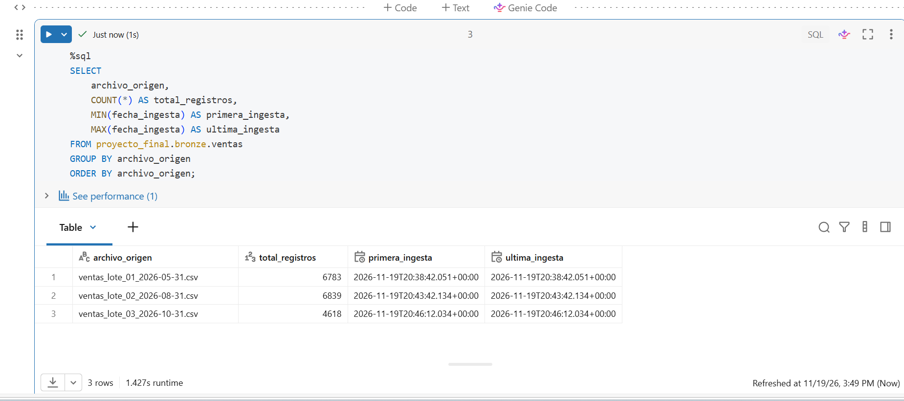

**Consideración importante:**

El checkpoint controla el reprocesamiento
de archivos, pero no garantiza por sí solo
la unicidad de las claves de negocio.

Por esta razón, la verificación de registros
duplicados se realiza mediante controles
adicionales de calidad de datos.

#### 4.2.8 Conclusión de la ingesta de ventas

La implementación demuestra el funcionamiento
de Auto Loader para procesar archivos CSV
mediante ejecuciones incrementales.

La solución incorpora trazabilidad por archivo,
mantiene el estado de procesamiento y almacena
los registros en formato Delta Lake.

La información queda disponible en la capa
Bronze para su posterior depuración y
validación en Silver.

---

### 4.3 Ingesta del catálogo de productos mediante COPY INTO

#### 4.3.1 Descripción de la fuente

**Notebook:** `notebooks/03_bronze_catalogo`

**Origen:** archivos JSON almacenados en Unity Catalog Volumes.

**Directorio de entrada:**

```text
/Volumes/proyecto_final/default/vol_landing/catalogo/
```

**Tabla de destino:**

```text
proyecto_final.bronze.catalogo
```

La fuente contiene la información maestra de productos
comercializados por ElectroCasa.

La estructura de Bronze contempla los siguientes campos:

| Campo | Tipo Bronze | Descripción |
|-------|-------------|-------------|
| producto_id | STRING | Identificador del producto. |
| nombre_producto | STRING | Nombre comercial del producto. |
| categoria | STRING | Categoría del producto. |
| marca | STRING | Marca del producto. |
| precio_lista | STRING | Precio original recibido. |
| activo | BOOLEAN | Indicador de disponibilidad o vigencia. |
| archivo_origen | STRING | Archivo JSON de procedencia. |
| fecha_ingesta | TIMESTAMP | Fecha y hora de incorporación. |

El campo `precio_lista` se conserva como STRING para
realizar su validación y conversión posterior en Silver.

#### 4.3.2 Exploración inicial del JSON

Antes de realizar la ingesta se explora el archivo fuente:

```python
df_catalogo = (
    spark.read
    .option("multiLine", "true")
    .json(ARCHIVO)
)

df_catalogo.printSchema()
print(df_catalogo.count())

display(df_catalogo.limit(10))
```

Esta exploración permite identificar:

- La estructura recibida.
- Los tipos de datos inferidos.
- La cantidad de registros.
- Una muestra de los productos.

La opción `multiLine=true` permite interpretar documentos
JSON distribuidos en múltiples líneas.

#### 4.3.3 Creación de la tabla Delta

Se define explícitamente la tabla de destino:

```sql
CREATE TABLE IF NOT EXISTS proyecto_final.bronze.catalogo (
    producto_id STRING,
    nombre_producto STRING,
    categoria STRING,
    marca STRING,
    precio_lista STRING,
    activo BOOLEAN,
    archivo_origen STRING,
    fecha_ingesta TIMESTAMP
)
USING DELTA;
```

El uso de `IF NOT EXISTS` permite ejecutar nuevamente
esta instrucción sin intentar recrear una tabla existente.

Delta Lake proporciona el formato de almacenamiento
utilizado por la arquitectura Medallion.

#### 4.3.4 Tecnología seleccionada: COPY INTO

La ingesta se implementa mediante la instrucción:

```sql
COPY INTO proyecto_final.bronze.catalogo
FROM (
    SELECT
        producto_id,
        nombre_producto,
        categoria,
        marca,
        precio_lista,
        activo,
        _metadata.file_name AS archivo_origen,
        current_timestamp() AS fecha_ingesta
    FROM '/Volumes/proyecto_final/default/vol_landing/catalogo'
)
FILEFORMAT = JSON
FORMAT_OPTIONS ('multiLine' = 'true');
```

Esta operación carga los archivos JSON disponibles
en el directorio de origen hacia la tabla Delta.

Durante el proceso también se incorporan metadatos
de trazabilidad.

#### 4.3.5 Justificación de COPY INTO frente a Auto Loader

Se seleccionó COPY INTO debido a que el catálogo
de productos se procesa mediante archivos JSON
en ejecuciones controladas.

Esta estrategia ofrece las siguientes ventajas:

**1. Simplicidad de implementación**

La carga se realiza directamente mediante SQL,
sin configurar un proceso de Structured Streaming.

**2. Procesamiento incremental**

COPY INTO mantiene información de los archivos
procesados y evita volver a cargarlos durante
ejecuciones posteriores de la misma operación.

**3. Idempotencia por archivo**

Si se vuelve a ejecutar COPY INTO sin incorporar
archivos nuevos, los archivos previamente registrados
se omiten.

**4. Compatibilidad con JSON multilínea**

La opción `multiLine=true` permite procesar
los documentos JSON utilizados en esta fuente.

**5. Integración con Delta Lake**

La operación almacena los registros directamente
en la tabla Delta de la capa Bronze.

Aunque Auto Loader también permite ingerir JSON,
COPY INTO resulta adecuado para este escenario
de cargas por lotes y ejecución SQL controlada.

#### 4.3.6 Primera carga del catálogo

Se incorpora el primer archivo JSON al volumen
de landing y se ejecuta COPY INTO.

El objetivo es registrar la carga inicial
de productos en la tabla Bronze.

**Evidencia: primera carga**

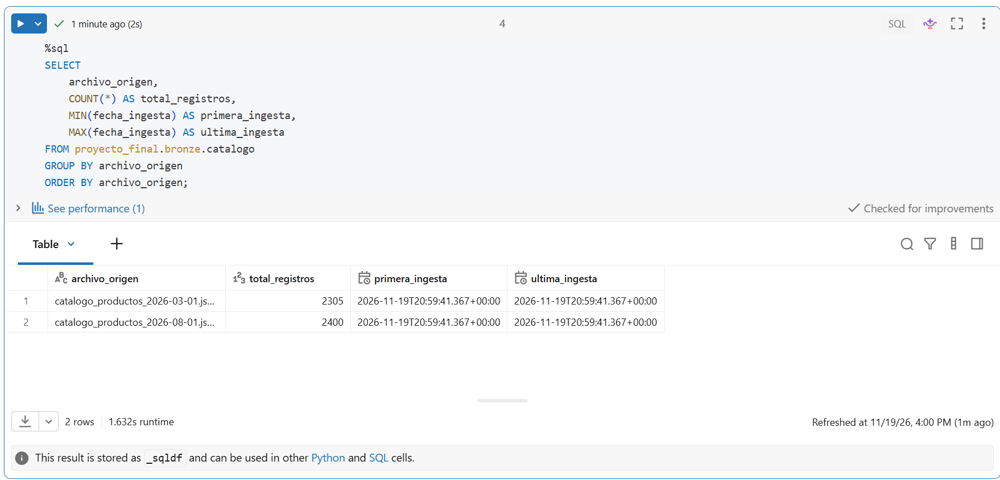

#### 4.3.7 Segunda carga del catálogo

Se incorpora una nueva entrega de archivos JSON
y se ejecuta nuevamente COPY INTO.

Esta prueba permite verificar el funcionamiento
de la carga incremental basada en el historial
de archivos procesados.

**Evidencia: segunda carga**

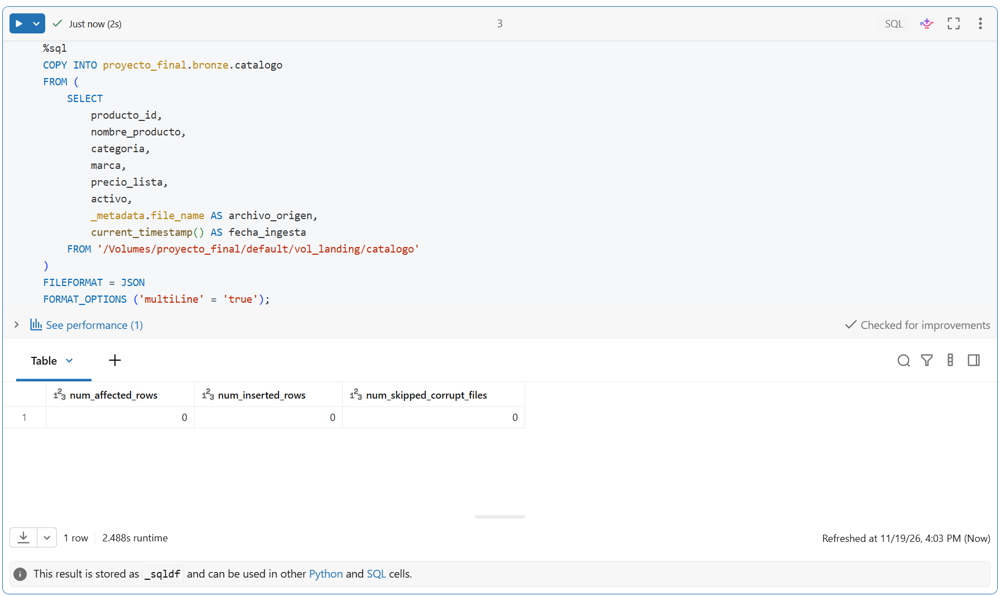

#### 4.3.8 Validación de la ingesta

Para verificar el resultado se ejecuta:

```sql
SELECT
    archivo_origen,
    COUNT(*) AS total_registros,
    MIN(fecha_ingesta) AS primera_ingesta,
    MAX(fecha_ingesta) AS ultima_ingesta
FROM proyecto_final.bronze.catalogo
GROUP BY archivo_origen
ORDER BY archivo_origen;
```

Esta consulta permite identificar:

- Los archivos que aportaron registros.
- La cantidad de registros por archivo.
- La primera fecha de ingesta.
- La última fecha de ingesta.

El control de reprocesamiento de COPY INTO
se realiza a nivel de archivo.

La verificación de duplicados de negocio
debe realizarse mediante controles adicionales
sobre las claves correspondientes.

#### 4.3.9 Conclusión de la ingesta del catálogo

La implementación demuestra el uso de COPY INTO
para incorporar archivos JSON hacia una tabla Delta.

La solución permite realizar cargas periódicas
sin configurar checkpoints externos y mantiene
información de trazabilidad sobre la procedencia
de los registros.

Los datos quedan disponibles en Bronze para
su posterior estandarización y validación
mediante los contratos de datos de Silver.

---

### 4.4 Ingesta de sucursales mediante COPY INTO

#### 4.4.1 Descripción de la fuente

**Notebook:** `notebooks/04_bronze_sucursales`

**Origen:** archivo CSV almacenado en Unity Catalog Volumes.

**Archivo explorado:**

```text
/Volumes/proyecto_final/default/vol_landing/sucursales/sucursales.csv
```

**Tabla de destino:**

```text
proyecto_final.bronze.sucursales
```

La fuente contiene información de las sucursales
comerciales de ElectroCasa.

Estos datos permiten identificar la ubicación
geográfica y las características de los
establecimientos de la empresa.

La estructura implementada es:

| Campo | Tipo Bronze | Descripción |
|-------|-------------|-------------|
| sucursal_id | STRING | Identificador de la sucursal. |
| nombre_sucursal | STRING | Nombre del establecimiento. |
| distrito | STRING | Distrito donde se ubica. |
| ciudad | STRING | Ciudad de la sucursal. |
| region | STRING | Región geográfica. |
| fecha_apertura | DATE | Fecha de apertura del establecimiento. |
| archivo_origen | STRING | Archivo CSV de procedencia. |
| fecha_ingesta | TIMESTAMP | Fecha y hora de incorporación. |

#### 4.4.2 Exploración inicial del archivo

Antes de realizar la ingesta se ejecuta
una lectura exploratoria:

```python
df_sucursales = (
    spark.read
    .option("header", "true")
    .option("inferSchema", "true")
    .csv(RUTA_SUCURSALES)
)

df_sucursales.printSchema()

print(
    "TOTAL DE REGISTROS:",
    df_sucursales.count()
)

display(df_sucursales.limit(10))
```

Esta operación permite:

- Identificar las columnas del CSV.
- Inspeccionar los tipos de datos inferidos.
- Determinar la cantidad inicial de registros.
- Revisar una muestra de las sucursales.

La exploración no modifica el archivo de origen.

#### 4.4.3 Creación de la tabla Delta

Se define la tabla Bronze mediante:

```sql
CREATE TABLE IF NOT EXISTS proyecto_final.bronze.sucursales (
    sucursal_id STRING,
    nombre_sucursal STRING,
    distrito STRING,
    ciudad STRING,
    region STRING,
    fecha_apertura DATE,
    archivo_origen STRING,
    fecha_ingesta TIMESTAMP
)
USING DELTA;
```

La tabla utiliza el formato Delta Lake.

La instrucción IF NOT EXISTS permite evitar
errores al volver a ejecutar su creación
cuando la tabla ya existe.

#### 4.4.4 Implementación de COPY INTO

La carga se realiza mediante:

```sql
COPY INTO proyecto_final.bronze.sucursales
FROM (
    SELECT
        sucursal_id,
        nombre_sucursal,
        distrito,
        ciudad,
        region,
        TO_DATE(fecha_apertura, 'yyyy-MM-dd') AS fecha_apertura,
        _metadata.file_name AS archivo_origen,
        current_timestamp() AS fecha_ingesta
    FROM '/Volumes/proyecto_final/default/vol_landing/sucursales'
)
FILEFORMAT = CSV
FORMAT_OPTIONS (
    'header' = 'true',
    'inferSchema' = 'true'
);
```

La instrucción permite incorporar los archivos CSV
disponibles en el directorio de landing.

Se agrega información de trazabilidad mediante
las columnas archivo_origen y fecha_ingesta.

#### 4.4.5 Justificación de COPY INTO frente a Auto Loader

Se seleccionó COPY INTO para procesar la información
de sucursales debido a las siguientes características:

**1. Fuente de datos maestros**

La información corresponde a los establecimientos
comerciales de ElectroCasa.

**2. Cargas controladas**

Los archivos se incorporan mediante ejecuciones
programadas o manuales, sin requerir un flujo
de streaming de larga duración.

**3. Simplicidad operativa**

COPY INTO permite realizar la ingesta mediante SQL,
sin administrar checkpoints externos.

**4. Control del reprocesamiento**

La operación mantiene información de los archivos
cargados y omite los previamente procesados
en ejecuciones posteriores.

**5. Integración con Delta Lake**

Los registros se almacenan directamente en
la tabla Delta de Bronze.

Auto Loader también podría utilizarse para
esta fuente, pero COPY INTO proporciona
una solución más sencilla para el patrón
de carga controlada implementado.

#### 4.4.6 Tratamiento de la fecha de apertura

Durante la ingesta se utiliza:

```sql
TO_DATE(fecha_apertura, 'yyyy-MM-dd')
```

Esta expresión convierte la fecha recibida
en el CSV al tipo DATE.

Se trata de una conversión técnica realizada
para ajustarse al esquema de destino.

Sin embargo, la validación de fechas inválidas,
rangos permitidos y reglas de negocio
corresponderá a la capa Silver.

**Consideración de diseño:**

La arquitectura Bronze busca preservar la
información recibida desde el origen.

En esta implementación se realiza una conversión
puntual de fecha. Para una estrategia estrictamente
raw, podría conservarse también el valor original
como STRING y realizar la conversión en Silver.

#### 4.4.7 Prueba de carga inicial

Se ejecutó COPY INTO para incorporar el archivo
de sucursales a la tabla Bronze.

La carga permite disponer de los registros
de establecimientos dentro de Unity Catalog.

#### 4.4.8 Segunda ejecución

Se realizó una ejecución posterior para
verificar el comportamiento de COPY INTO.

La prueba permite evaluar el tratamiento
de archivos previamente procesados.

**Evidencia: segunda carga de sucursales**

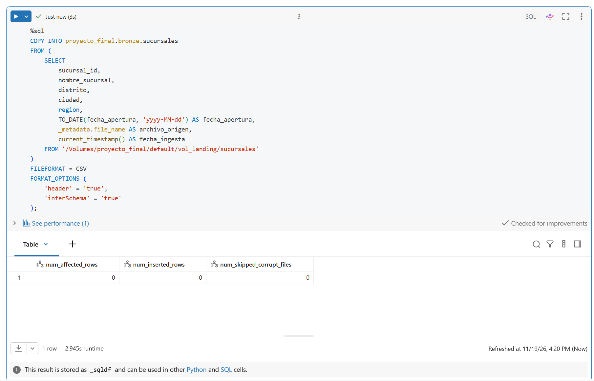

#### 4.4.9 Validación de la ingesta

La validación se realiza mediante:

```sql
SELECT
    archivo_origen,
    COUNT(*) AS total_registros,
    MIN(fecha_ingesta) AS primera_ingesta,
    MAX(fecha_ingesta) AS ultima_ingesta
FROM proyecto_final.bronze.sucursales
GROUP BY archivo_origen
ORDER BY archivo_origen;
```

Esta consulta permite verificar:

- Los archivos incorporados.
- La cantidad de registros por archivo.
- Las fechas de primera y última ingesta.
- La trazabilidad de los datos almacenados.

**Evidencia: validación de sucursales**

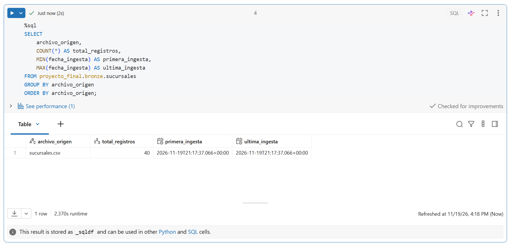

El control de archivos procesados no sustituye
las validaciones de duplicados por sucursal_id.

Esos controles deberán verificarse
mediante consultas específicas y contratos
de calidad en Silver.

#### 4.4.10 Conclusión de la ingesta de sucursales

La implementación demuestra el uso de COPY INTO
para incorporar archivos CSV de datos maestros.

La solución permite ejecutar cargas controladas,
mantener trazabilidad por archivo y almacenar
la información en formato Delta Lake.

La tabla resultante queda disponible para
los procesos posteriores de limpieza,
estandarización y validación en Silver.

---

### 4.5 Ingesta de empleados mediante Auto Loader

#### 4.5.1 Descripción de la fuente

**Notebook:** `notebooks/05_bronze_empleados`

**Origen:** archivos CSV almacenados en Unity Catalog Volumes.

**Directorio de entrada:**

```text
/Volumes/proyecto_final/default/vol_landing/empleados/
```

**Tabla de destino:**

```text
proyecto_final.bronze.empleados
```

La fuente contiene información de los empleados
de ElectroCasa y eventos relacionados con su
situación laboral.

Los datos se reciben en múltiples lotes y pueden
representar cambios ocurridos a lo largo del tiempo.

El esquema de entrada está compuesto por:

| Campo | Tipo Bronze | Descripción |
|-------|-------------|-------------|
| id_empleado | STRING | Identificador del empleado. |
| nombre | STRING | Nombre del empleado. |
| dni | STRING | Documento de identidad. |
| email | STRING | Correo electrónico. |
| salario | STRING | Remuneración registrada. |
| sucursal_id | STRING | Sucursal asociada al empleado. |
| cargo | STRING | Cargo del empleado. |
| tipo_evento | STRING | Tipo de evento laboral registrado. |
| fecha_evento | STRING | Fecha del evento. |
| fecha_registro | STRING | Fecha de registro del dato. |
| archivo_origen | STRING | Archivo CSV de procedencia. |
| fecha_ingesta | TIMESTAMP | Fecha y hora de incorporación. |

Los diez campos procedentes del origen se
conservan inicialmente como STRING.

Esta decisión permite evitar conversiones
prematuras y preservar los valores recibidos.

Las transformaciones y validaciones se
realizarán posteriormente en Silver.

#### 4.5.2 Exploración inicial

Antes de implementar la ingesta incremental
se realiza una exploración del primer lote:

```python
df_empleados = (
    spark.read
    .option("header", "true")
    .option("inferSchema", "true")
    .csv(ARCHIVO)
)

df_empleados.printSchema()

print(
    "TOTAL DE REGISTROS:",
    df_empleados.count()
)

display(df_empleados.limit(10))
```

Esta exploración permite identificar:

- Las columnas disponibles.
- Los tipos de datos inferidos.
- La cantidad inicial de registros.
- Una muestra de la información recibida.

La exploración no modifica los archivos de origen.

#### 4.5.3 Definición del esquema Bronze

Se utiliza un esquema explícito:

```python
ESQUEMA_EMPLEADOS = StructType([
    StructField("id_empleado", StringType(), True),
    StructField("nombre", StringType(), True),
    StructField("dni", StringType(), True),
    StructField("email", StringType(), True),
    StructField("salario", StringType(), True),
    StructField("sucursal_id", StringType(), True),
    StructField("cargo", StringType(), True),
    StructField("tipo_evento", StringType(), True),
    StructField("fecha_evento", StringType(), True),
    StructField("fecha_registro", StringType(), True)
])
```

El uso de un esquema explícito permite mantener
una estructura de lectura consistente entre lotes.

Se conserva la representación textual de los datos
para realizar las conversiones y validaciones
en etapas posteriores.

#### 4.5.4 Tecnología seleccionada: Auto Loader

La ingesta se implementa mediante:

```python
df_stream = (
    spark.readStream
    .format("cloudFiles")
    .option("cloudFiles.format", "csv")
    .option("header", "true")
    .schema(ESQUEMA_EMPLEADOS)
    .load(RUTA_ORIGEN)
)
```

Auto Loader permite incorporar archivos CSV
de manera incremental.

El estado de procesamiento se conserva en:

```text
/Volumes/proyecto_final/default/vol_landing/_checkpoints/empleados
```

Este checkpoint permite continuar el procesamiento
sin volver a ingerir los archivos ya registrados,
siempre que se conserve el estado correspondiente.

#### 4.5.5 Justificación de Auto Loader frente a COPY INTO

Se seleccionó Auto Loader para empleados debido
a las características de la fuente.

**1. Recepción de múltiples lotes**

La información se incorpora mediante entregas
sucesivas de archivos CSV.

**2. Seguimiento de nuevas entregas**

Auto Loader permite identificar nuevos archivos
y mantener el progreso mediante checkpoints.

**3. Preparación para el tratamiento histórico**

Los lotes contienen eventos que pueden representar
cambios en la información de los empleados.

La ingesta debe conservar estos registros para
que posteriormente puedan evaluarse en Silver.

**4. Procesamiento incremental**

Se utiliza Structured Streaming con:

```python
.trigger(availableNow=True)
```

Esta configuración procesa los archivos
disponibles y finaliza la ejecución.

**5. Trazabilidad**

Se registra el archivo de procedencia y la fecha
de incorporación de cada registro.

Aunque COPY INTO también puede realizar cargas
incrementales de archivos CSV, Auto Loader se
seleccionó para implementar un flujo incremental
con seguimiento persistente mediante checkpoints.

#### 4.5.6 Incorporación de metadatos

Durante la ingesta se agregan:

```python
df_bronze = (
    df_stream
    .withColumn(
        "archivo_origen",
        col("_metadata.file_name")
    )
    .withColumn(
        "fecha_ingesta",
        current_timestamp()
    )
)
```

Estos campos permiten conocer:

- El archivo del que procede cada registro.
- La fecha y hora de su incorporación.

La trazabilidad es especialmente importante
cuando existen múltiples eventos relacionados
con un mismo empleado.

#### 4.5.7 Escritura incremental en Delta Lake

La escritura se realiza mediante:

```python
query = (
    df_bronze.writeStream
    .format("delta")
    .outputMode("append")
    .option("checkpointLocation", RUTA_CHECKPOINT)
    .trigger(availableNow=True)
    .toTable(TABLA_DESTINO)
)

query.awaitTermination()
```

Se utiliza el modo append para incorporar
los registros recibidos.

En Bronze no se consolidan los eventos
de un empleado en un único registro.

Esto permite mantener la información necesaria
para el tratamiento histórico posterior.

#### 4.5.8 Primera carga de empleados

Se incorporó el primer lote de empleados
al volumen de landing.

La ejecución permitió almacenar los registros
iniciales en la tabla Bronze.

**Evidencia: primera carga**

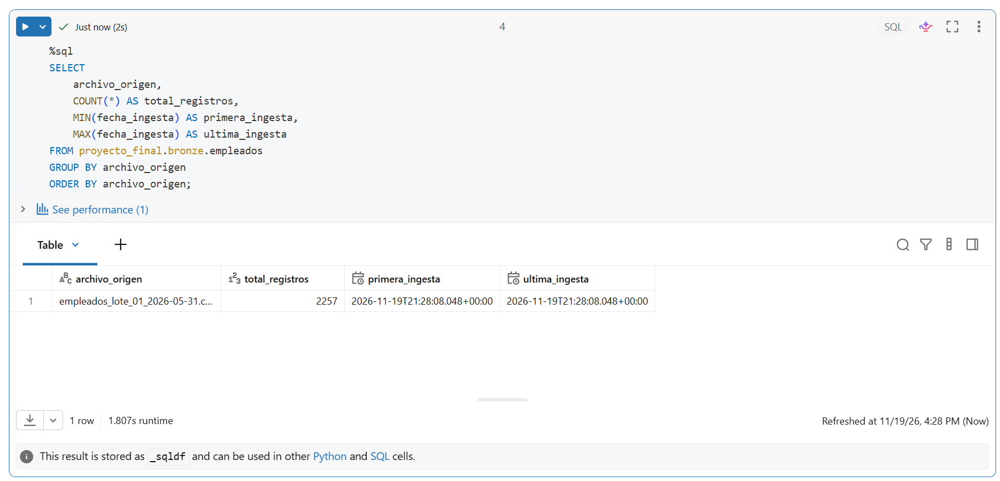

#### 4.5.9 Segunda carga de empleados

Se incorporó una nueva entrega de archivos CSV.

La ejecución permitió comprobar el procesamiento
incremental de nuevos archivos.

**Evidencia: segunda carga**

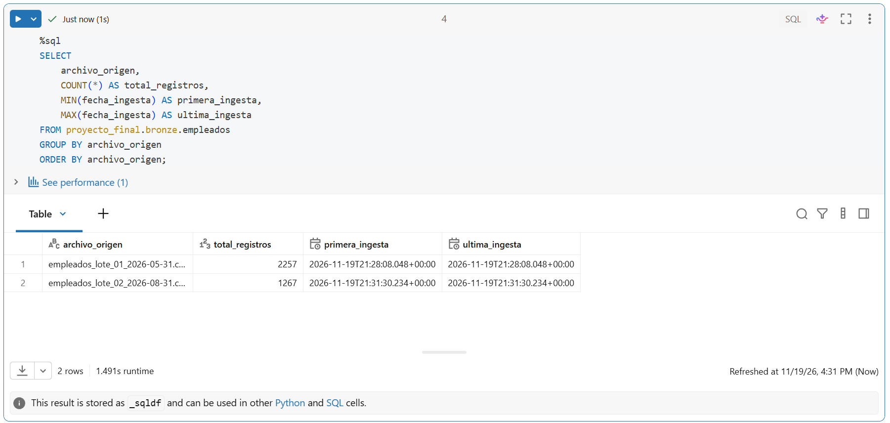

#### 4.5.10 Tercera carga de empleados

Se incorporó un tercer lote de información
de empleados.

La ejecución permitió verificar el comportamiento
del proceso ante nuevas entregas.

**Evidencia: tercera carga**

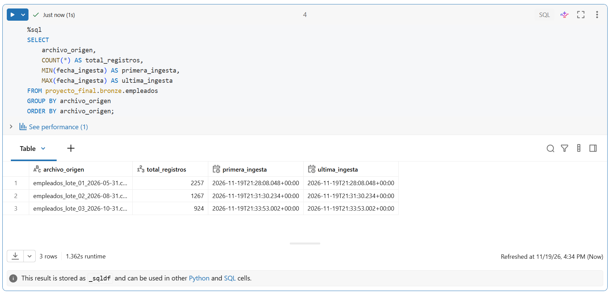

#### 4.5.11 Cuarta carga de empleados

Se incorporó un cuarto lote de archivos CSV.

Esta ejecución completa las pruebas de ingesta
incremental realizadas para la fuente de empleados.

**Evidencia: cuarta carga**

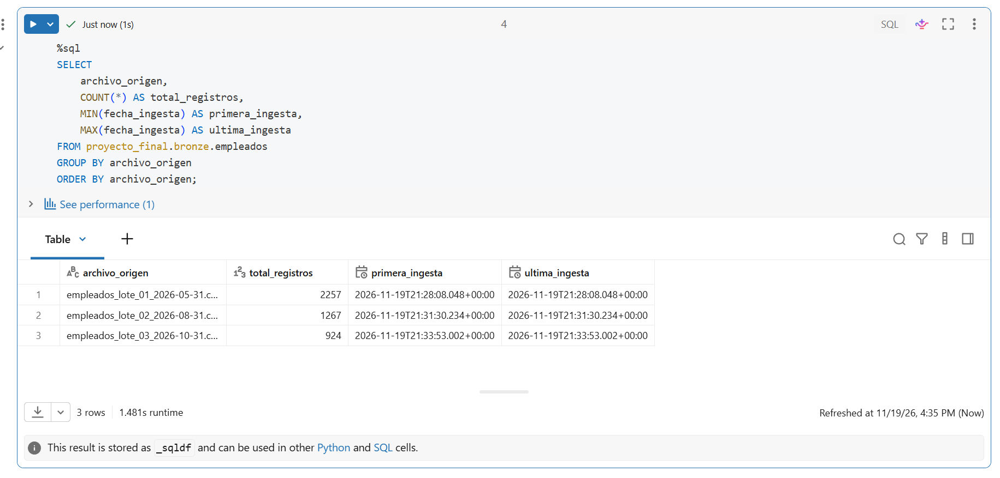

#### 4.5.12 Validación de la ingesta

Se utiliza la siguiente consulta:

```sql
SELECT
    archivo_origen,
    COUNT(*) AS total_registros,
    MIN(fecha_ingesta) AS primera_ingesta,
    MAX(fecha_ingesta) AS ultima_ingesta
FROM proyecto_final.bronze.empleados
GROUP BY archivo_origen
ORDER BY archivo_origen;
```

La consulta permite verificar:

- Los archivos incorporados.
- La cantidad de registros por archivo.
- Las fechas de ingesta.
- La trazabilidad de las diferentes entregas.

El control de reprocesamiento de Auto Loader
opera sobre los archivos procesados.

No debe confundirse con la eliminación de
eventos duplicados por empleado.

Estos controles se aplicarán durante el
procesamiento de Silver.

#### 4.5.13 Preparación para SCD Tipo 2

La información de empleados se utilizará
posteriormente para implementar una dimensión
histórica mediante Slowly Changing Dimensions
Tipo 2 (SCD Type 2).

Esta técnica permite conservar versiones
anteriores de un registro cuando cambian
sus atributos relevantes.

Los campos que facilitarán el procesamiento
histórico incluyen:

- `id_empleado`: identificador de negocio.
- `tipo_evento`: clasificación del evento registrado.
- `fecha_evento`: fecha asociada al cambio.
- `fecha_registro`: fecha de registro del evento.

La implementación de SCD Tipo 2 corresponde
a Silver y no se realiza durante esta ingesta.

En Bronze se conservan los registros recibidos
para permitir su procesamiento posterior.

#### 4.5.14 Protección de información sensible

La fuente contiene información personal
y potencialmente confidencial.

Entre los campos sensibles se identifican:

| Campo | Clasificación prevista |
|-------|------------------------|
| dni | Dato personal identificable. |
| nombre | Dato personal. |
| email | Dato personal de contacto. |
| salario | Información remunerativa confidencial. |

El proyecto contempla aplicar mecanismos
de gobierno y protección sobre estos campos.

Entre las medidas previstas se encuentran:

- Clasificación mediante etiquetas.
- Restricción de acceso por grupos.
- Enmascaramiento de columnas sensibles.
- Publicación de información autorizada.

La implementación de estos controles se
documentará cuando se configure la seguridad
definitiva de las tablas correspondientes.

#### 4.5.15 Conclusión de la ingesta de empleados

La implementación demuestra el uso de Auto Loader
para incorporar múltiples lotes de archivos CSV.

La solución mantiene el seguimiento de archivos
procesados, incorpora metadatos de auditoría
y conserva los eventos recibidos.

Los datos quedan disponibles en Bronze
para implementar posteriormente las reglas
de calidad, la protección de información
sensible y el historial SCD Tipo 2 en Silver.

---

### 4.6 Ingesta de reseñas mediante Auto Loader

#### 4.6.1 Descripción de la fuente

**Notebook:** `notebooks/06_bronze_resenas`

**Origen:** archivos JSON almacenados en Unity Catalog Volumes.

**Directorio de entrada:**

```text
/Volumes/proyecto_final/default/vol_landing/resenas/
```

**Archivo explorado:**

```text
resenas_lote_01_2026-07-31.json
```

**Tabla de destino:**

```text
proyecto_final.bronze.resenas
```

La fuente contiene información relacionada con
las reseñas y opiniones registradas sobre los
productos de ElectroCasa.

Los datos se reciben en archivos JSON,
que pueden contener estructuras anidadas.

La solución debe incorporar nuevas entregas
sin reprocesar los archivos previamente cargados.

#### 4.6.2 Exploración inicial del JSON

Antes de implementar la ingesta se explora
el primer archivo de reseñas:

```python
df_resenas = (
    spark.read
    .option("multiLine", "true")
    .json(ARCHIVO)
)

df_resenas.printSchema()

print(
    "TOTAL DE REGISTROS:",
    df_resenas.count()
)

display(df_resenas.limit(10))
```

Esta exploración permite:

- Identificar la estructura del JSON.
- Detectar columnas y tipos de datos.
- Reconocer estructuras anidadas.
- Consultar el número inicial de registros.
- Revisar una muestra de las reseñas.

La opción `multiLine=true` permite procesar
documentos JSON distribuidos en múltiples líneas.

#### 4.6.3 Conservación de la estructura anidada

A diferencia de otras fuentes, el esquema
de reseñas se obtiene directamente del
primer archivo JSON:

```python
ESQUEMA_RESENAS = df_resenas.schema
```

Esta decisión permite utilizar la estructura
detectada durante la exploración inicial.

En consecuencia, se conservan los campos
y estructuras anidadas definidos por ese esquema,
sin aplicar un aplanamiento durante la ingesta.

**Justificación técnica:**

La capa Bronze tiene como objetivo conservar
la información procedente del origen.

El procesamiento de atributos anidados,
la estandarización de valores y la aplicación
de reglas de negocio se realizarán en Silver.

**Consideración:**

El esquema inferido del primer lote se utiliza
como esquema de lectura de los lotes posteriores.

Si aparecen campos nuevos o cambios incompatibles,
será necesario revisar la configuración del esquema.

Esta implementación no configura explícitamente
la evolución automática de esquemas.

#### 4.6.4 Tecnología seleccionada: Auto Loader

La lectura incremental se implementa mediante:

```python
df_stream = (
    spark.readStream
    .format("cloudFiles")
    .option("cloudFiles.format", "json")
    .option("multiLine", "true")
    .schema(ESQUEMA_RESENAS)
    .load(RUTA_ORIGEN)
)
```

Auto Loader permite procesar archivos JSON
que se incorporan progresivamente al directorio.

El estado del procesamiento se almacena en:

```text
/Volumes/proyecto_final/default/vol_landing/_checkpoints/resenas
```

Este checkpoint permite mantener el progreso
de la ingesta entre ejecuciones sucesivas.

#### 4.6.5 Justificación de Auto Loader frente a COPY INTO

Se seleccionó Auto Loader para la fuente
de reseñas debido a las siguientes necesidades:

**1. Recepción de múltiples lotes**

Las reseñas se incorporan mediante entregas
sucesivas de archivos JSON.

**2. Procesamiento incremental**

Se requiere identificar los archivos nuevos
y evitar volver a procesar los registrados
en el checkpoint.

**3. Seguimiento persistente del procesamiento**

Auto Loader mantiene el estado de las ejecuciones,
facilitando la continuidad del proceso.

**4. Conservación de la estructura JSON**

La ingesta conserva la estructura correspondiente
al esquema del primer archivo, incluidos
los campos anidados definidos en él.

**5. Preparación para futuras automatizaciones**

La solución utiliza Structured Streaming,
lo que permite programar ejecuciones posteriores
para procesar nuevas entregas.

Aunque COPY INTO también admite archivos JSON,
Auto Loader se eligió para implementar un
procesamiento incremental con checkpoint.

La elección responde al patrón de ingesta,
no exclusivamente al formato del archivo.

#### 4.6.6 Incorporación de metadatos de auditoría

Durante la ingesta se agregan dos columnas:

```python
df_bronze = (
    df_stream
    .withColumn(
        "archivo_origen",
        col("_metadata.file_name")
    )
    .withColumn(
        "fecha_ingesta",
        current_timestamp()
    )
)
```

**archivo_origen**

Identifica el archivo JSON desde el cual
se incorporó el registro.

**fecha_ingesta**

Registra el momento de incorporación a Bronze.

Estos campos permiten realizar controles
de trazabilidad y auditoría.

#### 4.6.7 Escritura incremental en Delta Lake

La escritura se implementa mediante:

```python
query = (
    df_bronze.writeStream
    .format("delta")
    .outputMode("append")
    .option("checkpointLocation", RUTA_CHECKPOINT)
    .trigger(availableNow=True)
    .toTable(TABLA_DESTINO)
)

query.awaitTermination()
```

La información se almacena en formato Delta Lake.

El modo append incorpora los registros recibidos
sin reemplazar los datos existentes.

La configuración:

```python
.trigger(availableNow=True)
```

permite procesar los archivos disponibles
y finalizar la ejecución.

#### 4.6.8 Primera carga de reseñas

Se incorporó el primer lote JSON al volumen
de landing.

Se ejecutó el proceso de Auto Loader para
almacenar los registros iniciales en Bronze.

**Evidencia: primera carga**

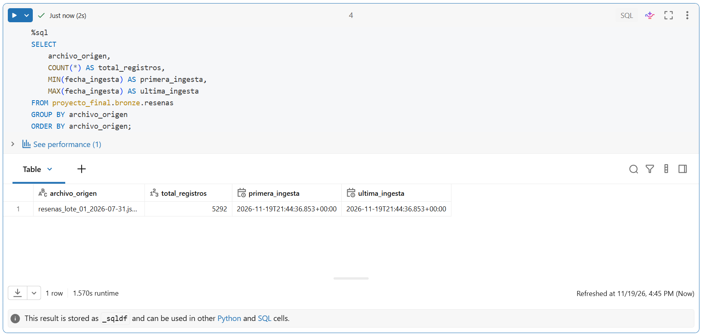

#### 4.6.9 Segunda carga de reseñas

Se incorporó una nueva entrega de archivos JSON.

La ejecución permitió probar la ingesta
incremental de archivos adicionales.

**Evidencia: segunda carga**

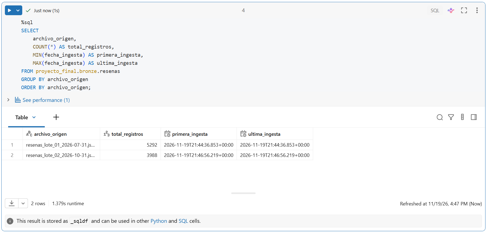

#### 4.6.10 Tercera carga de reseñas

Se incorporó un tercer lote y se ejecutó
nuevamente el notebook.

Esta prueba permitió revisar el comportamiento
del flujo ante nuevas entregas.

**Evidencia: tercera carga**

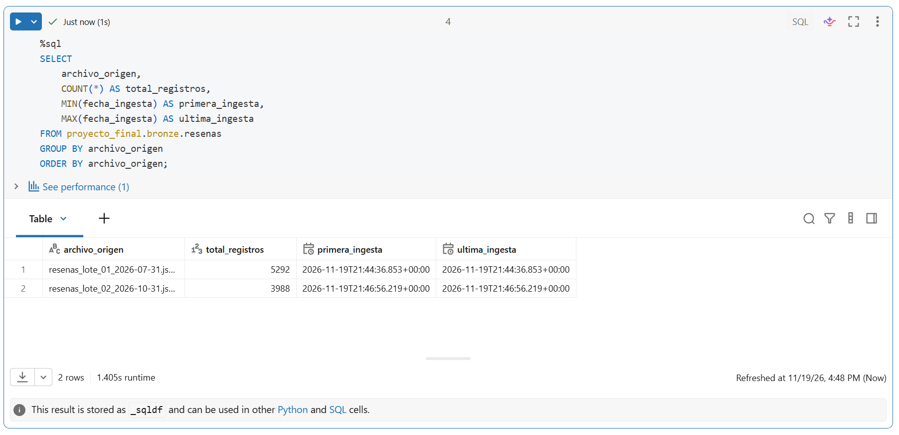

#### 4.6.11 Validación de la ingesta

La validación se realiza mediante:

```sql
SELECT
    archivo_origen,
    COUNT(*) AS total_registros,
    MIN(fecha_ingesta) AS primera_ingesta,
    MAX(fecha_ingesta) AS ultima_ingesta
FROM proyecto_final.bronze.resenas
GROUP BY archivo_origen
ORDER BY archivo_origen;
```

Esta consulta permite conocer:

- Los archivos incorporados.
- La cantidad de registros por archivo.
- La primera fecha de ingesta.
- La última fecha de ingesta.

El checkpoint evita el reprocesamiento
de archivos ya registrados en el flujo,
siempre que se conserve su estado.

Sin embargo, no elimina automáticamente
reseñas duplicadas que puedan existir
en archivos distintos.

Los controles de calidad correspondientes
se implementarán posteriormente en Silver.

#### 4.6.12 Conclusión de la ingesta de reseñas

La implementación demuestra el uso de
Auto Loader para procesar archivos JSON
mediante una estrategia incremental.

La solución conserva la estructura definida
en el esquema de origen, agrega metadatos
de auditoría y almacena los registros
en formato Delta Lake.

La información queda disponible para
los procesos posteriores de limpieza,
tratamiento de estructuras anidadas
y validación en Silver.

---

### 4.7 Ingesta de devoluciones mediante Auto Loader

#### 4.7.1 Descripción de la fuente

**Notebook:** `notebooks/07_bronze_devoluciones`

**Formato:** CSV.

**Origen:**

```text
/Volumes/proyecto_final/default/vol_landing/devoluciones/
```

**Destino:**

```text
proyecto_final.bronze.devoluciones
```

La fuente contiene información sobre las devoluciones
realizadas por los clientes de ElectroCasa.

Los registros permiten identificar las ventas
relacionadas, los productos devueltos,
los motivos y los importes de reembolso.

La estructura de Bronze es:

| Campo | Tipo | Descripción |
|-------|------|-------------|
| devolucion_id | STRING | Identificador de la devolución. |
| venta_id | STRING | Venta relacionada. |
| sucursal_id | STRING | Sucursal asociada. |
| producto_id | STRING | Producto devuelto. |
| motivo | STRING | Motivo de devolución. |
| monto_reembolso | STRING | Importe del reembolso. |
| fecha_devolucion | STRING | Fecha de devolución. |
| archivo_origen | STRING | Archivo CSV de procedencia. |
| fecha_ingesta | TIMESTAMP | Fecha de incorporación. |

Los campos originales se conservan como STRING
para realizar las validaciones y conversiones
correspondientes en Silver.

#### 4.7.2 Exploración del archivo fuente

Antes de realizar la ingesta se explora
el primer lote:

```python
df_devoluciones = (
    spark.read
    .option("header", "true")
    .option("inferSchema", "true")
    .csv(ARCHIVO)
)

df_devoluciones.printSchema()

print(
    "TOTAL DE REGISTROS:",
    df_devoluciones.count()
)

display(df_devoluciones.limit(10))
```

La exploración permite conocer la estructura,
cantidad de registros y contenido inicial
de la fuente.

#### 4.7.3 Implementación de Auto Loader

La ingesta utiliza Structured Streaming:

```python
df_stream = (
    spark.readStream
    .format("cloudFiles")
    .option("cloudFiles.format", "csv")
    .option("header", "true")
    .schema(ESQUEMA_DEVOLUCIONES)
    .load(RUTA_ORIGEN)
)
```

El estado del procesamiento se almacena en:

```text
/Volumes/proyecto_final/default/vol_landing/_checkpoints/devoluciones
```

Este checkpoint permite conservar el progreso
de las ejecuciones incrementales.

#### 4.7.4 Justificación de Auto Loader frente a COPY INTO

Se seleccionó Auto Loader debido a que
las devoluciones se reciben mediante
múltiples lotes de archivos CSV.

La implementación permite incorporar
nuevas entregas sin volver a procesar
los archivos registrados en el checkpoint.

Las principales razones son:

1. Procesamiento incremental de archivos.
2. Seguimiento persistente mediante checkpoints.
3. Conservación de los registros originales.
4. Incorporación de metadatos de trazabilidad.
5. Posibilidad de automatizar ejecuciones posteriores.

Aunque COPY INTO también podría procesar esta fuente,
Auto Loader se eligió para mantener un flujo
incremental basado en Structured Streaming.

#### 4.7.5 Escritura en Delta Lake

La escritura se realiza mediante:

```python
query = (
    df_bronze.writeStream
    .format("delta")
    .outputMode("append")
    .option("checkpointLocation", RUTA_CHECKPOINT)
    .trigger(availableNow=True)
    .toTable(TABLA_DESTINO)
)

query.awaitTermination()
```

La ejecución procesa los archivos disponibles
y finaliza una vez completado el trabajo.

Se agregan las columnas:

- `archivo_origen`: archivo del que procede el registro.
- `fecha_ingesta`: momento de incorporación a Bronze.

#### 4.7.6 Pruebas de ingesta incremental

Para comprobar el funcionamiento de Auto Loader
se realizaron cuatro ejecuciones con lotes
sucesivos de devoluciones.

**Primera carga**

Se procesó el primer lote de archivos CSV
y se incorporaron los registros iniciales a Bronze.


**Segunda carga**

Se incorporó una nueva entrega de archivos
y se ejecutó nuevamente el proceso incremental.

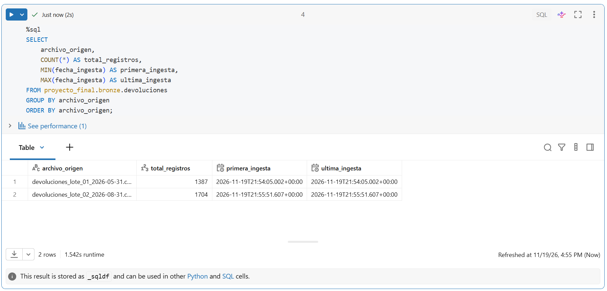

**Tercera carga**

Se ejecutó Auto Loader con un tercer lote,
verificando el procesamiento de nuevos archivos.


**Cuarta carga**

Se procesó un cuarto lote para completar
las pruebas de ingesta incremental.

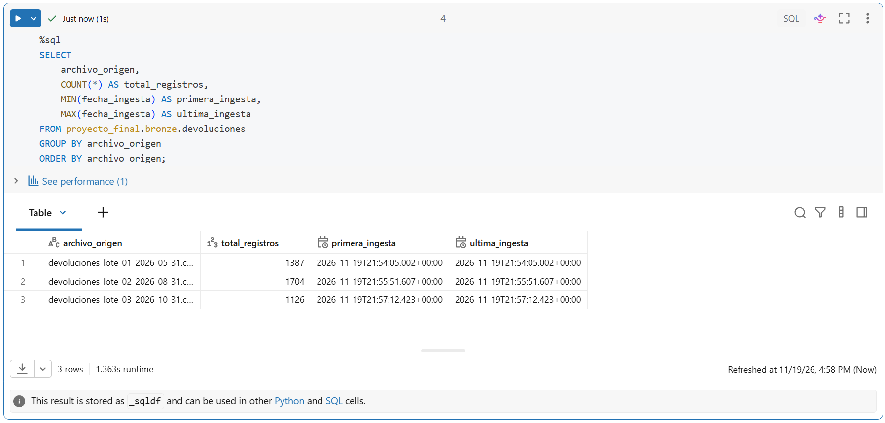

#### 4.7.7 Validación de la ingesta

Para revisar los archivos procesados se utiliza:

```sql
SELECT
    archivo_origen,
    COUNT(*) AS total_registros,
    MIN(fecha_ingesta) AS primera_ingesta,
    MAX(fecha_ingesta) AS ultima_ingesta
FROM proyecto_final.bronze.devoluciones
GROUP BY archivo_origen
ORDER BY archivo_origen;
```

Esta consulta permite identificar:

- Los archivos incorporados.
- La cantidad de registros por archivo.
- Las fechas de ingesta.
- La trazabilidad de las ejecuciones.

El checkpoint controla el reprocesamiento
de archivos, pero no garantiza la ausencia
de devoluciones duplicadas en archivos distintos.

#### 4.7.8 Preparación para Silver

En Silver se implementarán controles como:

- Validación de `devolucion_id`.
- Comprobación de la relación con `venta_id`.
- Conversión de `monto_reembolso` a tipo numérico.
- Validación de fechas de devolución.
- Detección de registros duplicados.
- Aplicación de contratos de datos.

Estas reglas no se ejecutan en el notebook
de ingesta Bronze.

#### 4.7.9 Conclusión

La ingesta de devoluciones mediante Auto Loader
permite incorporar múltiples entregas de archivos
CSV hacia una tabla Delta.

La implementación conserva los campos originales,
agrega metadatos de auditoría y mantiene el
estado de procesamiento mediante checkpoints.

Los registros quedan disponibles para los
procesos de validación y limpieza en Silver.

---

### 4.8 Ingesta incremental desde Azure SQL Database mediante Lakeflow Connect

#### 4.8.1 Descripción de la integración

Como parte del proyecto ElectroCasa, se implementó una conexión
entre Databricks y Azure SQL Database para incorporar información
del seguimiento de envíos a la capa Bronze.

A diferencia de las fuentes anteriores, que utilizan archivos
CSV y JSON, esta información procede de una base de datos
relacional SQL Server alojada en Azure.

La integración se realizó mediante Lakeflow Connect,
utilizando un conector administrado basado en consultas
(Query-based Connector).

**Configuración de la fuente:**

| Componente | Valor |
|------------|-------|
| Sistema de origen | Azure SQL Database |
| Base de datos | `electrocasadb` |
| Esquema de origen | `dbo` |
| Tabla de origen | `trackingenvios` |
| Tecnología | Databricks Lakeflow Connect |
| Tipo de conector | Query-based Connector |
| Tabla de destino | `proyecto_final.bronze.tracking_envios` |
| Formato de destino | Delta Lake |

El objetivo es disponer de la información de envíos
dentro de Databricks para integrarla posteriormente
con los demás datos del proyecto.

#### 4.8.2 Configuración de la conexión con Azure SQL

Primero se configuró una conexión de Unity Catalog
hacia Azure SQL Database.

**Nombre de conexión:**

```text
conexion_azure_sql_electrocasa
```

**Catálogo federado:**

```text
conexion_azure_sql_electrocasa_catalog
```

Esta conexión permite acceder a las tablas de Azure SQL
desde Databricks mediante Unity Catalog.

El catálogo federado expone la tabla:

```text
conexion_azure_sql_electrocasa_catalog.dbo.trackingenvios
```

La autenticación se configuró mediante usuario y contraseña.

Por seguridad, las credenciales no se incluyen en
el repositorio ni en esta documentación.

**Evidencia 1: Conexión con Azure SQL Database**

La siguiente captura demuestra la configuración
de la conexión entre Databricks y Azure SQL.


#### 4.8.3 Justificación de Lakeflow Connect

Para esta fuente se seleccionó Lakeflow Connect
en lugar de mantener una carga manual mediante PySpark.

La decisión se fundamenta en las siguientes características:

1. Permite configurar un pipeline de ingesta administrada.
2. Facilita la integración con una fuente SQL Server.
3. Admite la definición de una clave primaria.
4. Permite establecer una columna para el seguimiento incremental.
5. Centraliza la administración y ejecución del proceso.
6. Permite versionar la configuración mediante YAML.

Durante el desarrollo se realizó una prueba inicial
de lectura manual desde Azure SQL.

Posteriormente, esta implementación fue reemplazada
por el pipeline administrado de Lakeflow Connect,
que constituye la solución definitiva de Bronze.

La carga manual no forma parte del flujo final.

#### 4.8.4 Configuración del pipeline

Se creó el pipeline:

```text
pl_ingesta_tracking_envios
```

Su configuración permite replicar información
desde el catálogo federado hacia Bronze.

| Parámetro | Configuración |
|-----------|---------------|
| Pipeline | `pl_ingesta_tracking_envios` |
| Tipo | `MANAGED_INGESTION` |
| Fuente | `FOREIGN_CATALOG` |
| Catálogo de origen | `conexion_azure_sql_electrocasa_catalog` |
| Esquema de origen | `dbo` |
| Tabla de origen | `trackingenvios` |
| Catálogo de destino | `proyecto_final` |
| Esquema de destino | `bronze` |
| Tabla de destino | `tracking_envios` |
| Clave primaria | `evento_id` |
| Columna cursor | `fecha_modificacion` |

**Clave primaria: evento_id**

Se utiliza para identificar los registros
de seguimiento de envíos.

**Columna cursor: fecha_modificacion**

Se utiliza para realizar el seguimiento de
los cambios de la información en el origen.

La configuración permite realizar ejecuciones
sucesivas del pipeline sin depender de una
carga manual mediante notebooks.

#### 4.8.5 Configuración declarativa mediante YAML

Para mantener la configuración del pipeline
bajo control de versiones se creó el archivo:

```text
pipelines/bronze/pl_ingesta_tracking_envios.yml
```

Este archivo contiene la definición del pipeline,
incluyendo el origen, destino, clave primaria
y columna de seguimiento incremental.

**YAML implementado:**

```yaml
# ============================================================
# PROYECTO FINAL - ELECTROCASA
# CAPA BRONZE: INGESTA INCREMENTAL DESDE AZURE SQL SERVER
#
# Tecnologia: Databricks Lakeflow Connect
# Conector: Query-based mediante Unity Catalog Federation
# Origen: Azure SQL Database - electrocasadb.dbo.trackingenvios
# Destino: proyecto_final.bronze.tracking_envios
# ============================================================

resources:
  pipelines:
    pl_ingesta_tracking_envios:
      name: pl_ingesta_tracking_envios

      catalog: proyecto_final
      schema: default

      channel: PREVIEW
      photon: true
      pipeline_type: MANAGED_INGESTION

      ingestion_definition:
        source_type: FOREIGN_CATALOG
        ingest_from_uc_foreign_catalog: true

        objects:
          - table:
              source_catalog: conexion_azure_sql_electrocasa_catalog
              source_schema: dbo
              source_table: trackingenvios

              destination_catalog: proyecto_final
              destination_schema: bronze
              destination_table: tracking_envios

              table_configuration:
                primary_keys:
                  - evento_id

                query_based_connector_config:
                  cursor_columns:
                    - fecha_modificacion
```

**Justificación del uso de YAML**

La configuración declarativa permite:

- Conservar la definición del pipeline en GitHub.
- Mantener un historial de cambios.
- Documentar los parámetros técnicos del conector.
- Facilitar su mantenimiento.
- Preparar el recurso para un despliegue automatizado.

El archivo forma parte de la estructura prevista
para Databricks Declarative Automation Bundles.

No obstante, el YAML por sí solo no despliega
todos los componentes de ElectroCasa.

Para reproducir la solución en otro entorno
también será necesario configurar:

- La conexión con Azure SQL Database.
- Las credenciales correspondientes.
- El catálogo federado.
- Los permisos de acceso.
- El archivo principal `databricks.yml`.
- Los recursos restantes de Silver, Gold y los jobs.

Por tanto, esta configuración constituye
el recurso de ingesta Bronze que posteriormente
se integrará al despliegue general.

#### 4.8.6 Primera ejecución del pipeline

Una vez configurado el conector,
se ejecutó el pipeline:

```text
pl_ingesta_tracking_envios
```

La primera ejecución realizó la ingesta inicial
desde Azure SQL Database hacia:

```text
proyecto_final.bronze.tracking_envios
```

**Evidencia 2: Primera ejecución del pipeline**

La siguiente captura muestra la ejecución
inicial del proceso de Lakeflow Connect.


#### 4.8.7 Validación de la primera ejecución

Después de finalizar el pipeline se comprobó
la cantidad de registros incorporados.

La validación se realizó mediante una consulta
equivalente a:

```sql
SELECT
    COUNT(*) AS total_registros,
    COUNT(DISTINCT evento_id) AS eventos_distintos,
    COUNT(*) - COUNT(DISTINCT evento_id) AS duplicados
FROM proyecto_final.bronze.tracking_envios;
```

**Resultados:**

| Indicador | Resultado |
|-----------|-----------|
| Registros en Bronze | 15 139 |
| Eventos distintos | 15 139 |
| Duplicados por `evento_id` | 0 |

Los resultados permitieron comprobar
que los registros cargados no presentaban
identificadores duplicados.

**Evidencia 3: Validación de la primera ejecución**


#### 4.8.8 Segunda ejecución incremental

Para comprobar el comportamiento del pipeline
se realizó una segunda ejecución.

El objetivo fue verificar que una ejecución
posterior no generara duplicados sobre
los registros existentes en Bronze.

**Evidencia 4: Segunda ejecución del pipeline**

La siguiente captura muestra la ejecución
posterior del conector administrado.


#### 4.8.9 Validación de la segunda ejecución

Después de la segunda ejecución se volvió
a consultar la tabla de destino.

**Resultados:**

| Indicador | Primera ejecución | Segunda ejecución |
|-----------|-------------------|-------------------|
| Total de registros | 15 139 | 15 139 |
| Eventos distintos | 15 139 | 15 139 |
| Duplicados por `evento_id` | 0 | 0 |

Se verificó que la cantidad de registros
permaneció constante y que no se generaron
duplicados por `evento_id`.

Esta prueba demuestra que la segunda ejecución
no produjo duplicaciones en la tabla de destino.

Para comprobar cuántos cambios procesó internamente
cada ejecución deben revisarse las métricas
y los registros del pipeline.

**Evidencia 5: Validación de la segunda ejecución**


#### 4.8.10 Resultado de la integración

La implementación permitió establecer
una integración entre Azure SQL Database
y Databricks mediante Lakeflow Connect.

Se consiguió:

1. Configurar la conexión con Azure SQL.
2. Crear un catálogo federado de origen.
3. Configurar un pipeline administrado.
4. Definir `evento_id` como clave primaria.
5. Definir `fecha_modificacion` como columna cursor.
6. Cargar 15 139 registros hacia Bronze.
7. Ejecutar nuevamente el pipeline sin generar duplicados.
8. Incorporar la configuración YAML al repositorio GitHub.

La tabla definitiva es:

```text
proyecto_final.bronze.tracking_envios
```

Esta información queda disponible para su
posterior integración y transformación en Silver.

#### 4.8.11 Conclusión

La implementación de Lakeflow Connect completa
la integración de las fuentes del proyecto ElectroCasa.

A diferencia de las ingestas de archivos,
este proceso utiliza un conector administrado
para acceder a Azure SQL Database.

Las pruebas realizadas permitieron comprobar
la carga de los registros y la ausencia de
duplicados por identificador después de
dos ejecuciones.

La configuración YAML permite mantener
versionado el pipeline y constituye
un componente del futuro despliegue
automatizado del proyecto.

## 5. Capa Silver: limpieza, calidad e historización

### 5.1 Alcance y arquitectura de Silver

Se implementaron las transformaciones de las **siete fuentes** en el catálogo `proyecto_final`, mediante notebooks PySpark/SQL que leen las tablas `bronze`, aplican reglas de negocio y escriben tablas Delta administradas bajo `silver`. La finalidad es que **Gold consuma datos depurados, tipados y deduplicados**, sin incorporar registros rechazados. Los contratos asociados se mantienen en `contratos/<fuente>.yml`.

> **Alcance de la evidencia:** las transformaciones documentadas se ejecutaron mediante notebooks. Su integración como *Lakeflow Spark Declarative Pipeline* con expectativas `dp.expect`/`CONSTRAINT EXPECT` se abordará en la etapa de automatización; no se presenta como un pipeline ya desplegado. Los datos e historiales de Bronze se conservan.

| Fuente | Notebook | Tabla Silver | Decisión principal |
|---|---|---|---|
| Sucursales | `notebooks/08_silver_sucursales` | `proyecto_final.silver.sucursales` | Normalización de ubicación, campos obligatorios y deduplicación por sucursal. |
| Catálogo | `notebooks/09_silver_catalogo` | `proyecto_final.silver.catalogo` | Último snapshot válido, categorías/precios normalizados, productos inactivos conservados. |
| Empleados | `notebooks/10_silver_empleados` | `proyecto_final.silver.empleados` | Historia **SCD Tipo 2**, orden cronológico, bloqueo de historiales sin alta fiable y máscaras de datos. |
| Reseñas | `notebooks/11_silver_resenas` | `proyecto_final.silver.resenas` | Preservación de estructuras anidadas, calidad de calificaciones y deduplicación. |
| Ventas | `notebooks/12_silver_ventas` | `proyecto_final.silver.ventas` | Normalización monetaria, pagos, referencias y vendedor nulo permitido en ecommerce. |
| Devoluciones | `notebooks/13_silver_devoluciones` | `proyecto_final.silver.devoluciones` | Validación contra venta Silver y montos de reembolso. |
| Tracking de envíos | `notebooks/14_silver_tracking_envios` | `proyecto_final.silver.tracking_envios` | Historial de estados por evento, normalización de courier y validación de venta. |

### 5.2 Tabla centralizada de cuarentena

Todos los registros que incumplen las reglas críticas se registran en **`proyecto_final.silver.cuarentena`**. Su estructura es: `fuente STRING`, `clave_registro STRING`, `motivo_rechazo STRING`, `fecha_rechazo TIMESTAMP`, `datos_originales STRING` (JSON del registro Bronze) y `archivo_origen STRING`. En Tracking, cuya fuente es Azure SQL Database, este último campo identifica el sistema `Azure SQL Database - dbo.TrackingEnvios` en lugar de un archivo físico.

**Política adoptada:** cuarentena y trazabilidad, en lugar de descartar filas incorrectas silenciosamente. Las entradas conservan la fuente, la causa del rechazo y los datos originales para revisión/auditoría. Las duplicaciones de negocio se resuelven separadamente por las llaves definidas por fuente. Las políticas declaradas en los YAML deben coincidir con esta implementación: las reglas críticas **envían a cuarentena**, aunque alguna plantilla inicial las denominara `drop`.

**Estado final verificado en la carga de Tracking:**

| Fuente | Filas en cuarentena |
|---|---:|
| Catálogo | 51 |
| Empleados | 181 |
| Reseñas | 223 |
| Ventas | 580 |
| Devoluciones | 265 |
| Tracking de envíos | 476 |
| Sucursales | 0 (sin fila de origen en el resumen compartido) |
| **Total** | **1 776** |

La consulta de control permite volver a verificar los acumulados, sin exponer datos personales:

```sql
SELECT fuente, COUNT(*) AS rechazados
FROM proyecto_final.silver.cuarentena
GROUP BY fuente
ORDER BY fuente;
```

**Reejecución:** Ventas, Devoluciones y Tracking reemplazan lógicamente sus entradas previas mediante `DELETE WHERE fuente = ...` y posterior `append`; **ambas instrucciones no son una única transacción atómica**. Empleados usa `overwrite` acotado por `replaceWhere`. Para reproducibilidad en un pipeline automatizado se revisará el comportamiento idempotente, especialmente de las cargas de cuarentena que usan `append` simple.

### 5.3 Sucursales: referencia geográfica normalizada

El notebook `08_silver_sucursales` lee la tabla Bronze, conserva el JSON original para auditoría, aplica `TRIM` a los campos de identificación y ubicación, `INITCAP` al nombre de la ciudad y corrige explícitamente `Huanuco` a `Huánuco`. Se requieren identificador, nombre, distrito, ciudad, región y fecha de apertura no nulos; la fecha debe estar comprendida entre `1900-01-01` y el día de ejecución.

La deduplicación utiliza `ROW_NUMBER() OVER (PARTITION BY sucursal_id ORDER BY fecha_ingesta DESC, ...)`, con criterios adicionales de desempate. Se escribe una fila por sucursal en Delta `silver.sucursales` mediante `overwrite`. Los registros inválidos se etiquetan con `CAMPO_OBLIGATORIO_INVALIDO` o `FECHA_APERTURA_INVALIDA`; los duplicados excedentes con `SUCURSAL_DUPLICADA`. El notebook concilia `total_bronze = total_silver + total_rechazados` antes de guardar. Una consulta adicional identifica nombres de sucursales sin el texto «ElectroCasa», como **control exploratorio**, no como rechazo automático.

**Evidencias:**

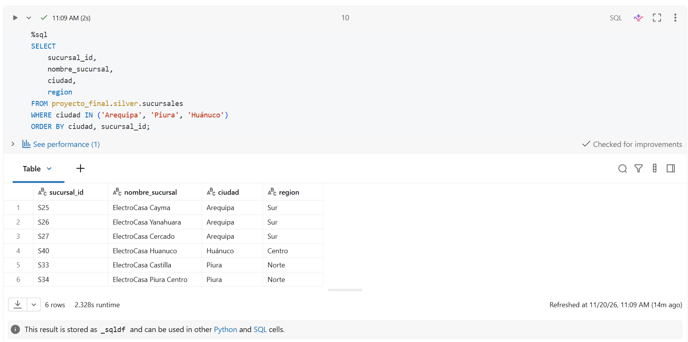

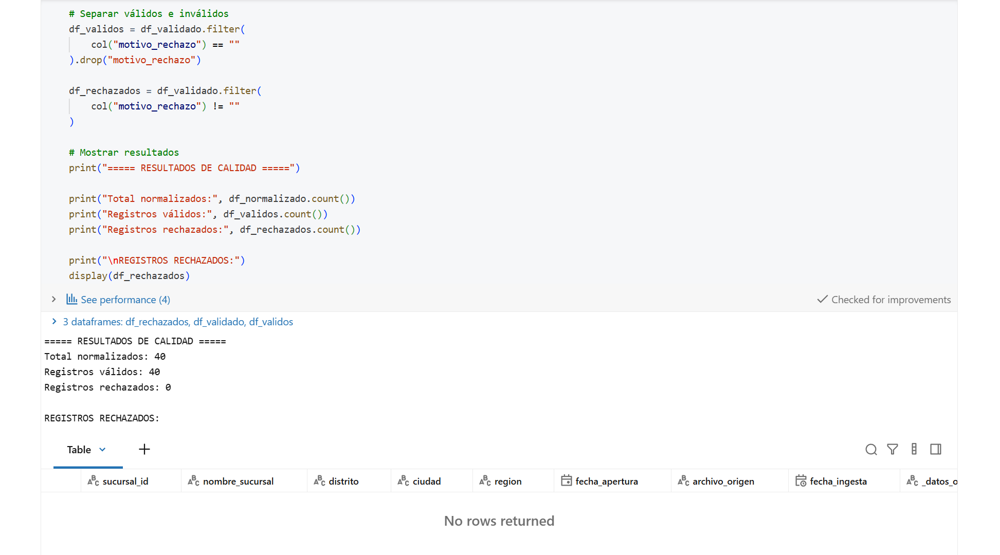

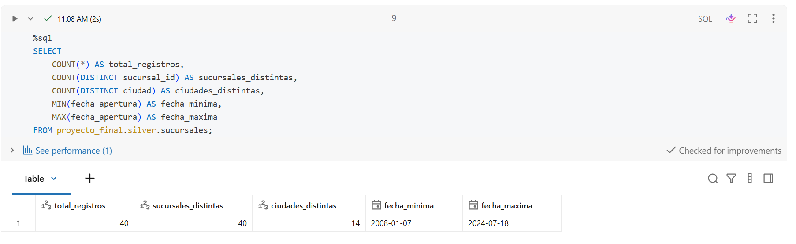

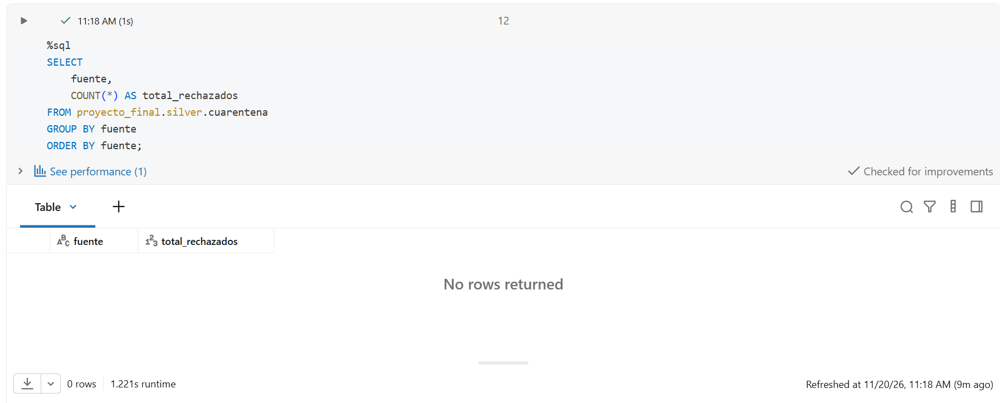

### 5.4 Catálogo: snapshot vigente y calidad de producto

El notebook `09_silver_catalogo` extrae `fecha_snapshot` del `archivo_origen` y **selecciona la fecha de snapshot más reciente** (agosto de 2026). Los nombres y categorías se limpian con `TRIM`; las categorías se normalizan a minúsculas sin tildes y con guiones bajos. El precio se depura de símbolos monetarios y separadores y se convierte con `TRY_CAST` a `DECIMAL(12,2)`; se rechazan valores nulos, no convertibles o no positivos.

Se validan `producto_id`, `nombre_producto`, categoría entre `linea_blanca`, `cocina`, `electronica`, `climatizacion` y `entretenimiento`, precio positivo y valor no nulo de `activo`. Los productos con `activo = false` **no se excluyen por estar descontinuados**: conservan utilidad para relaciones históricas. Duplicados del mismo `producto_id` se consolidan determinísticamente, reteniendo una sola fila. Los rechazos, incluidos posibles duplicados excedentes, se envían a la cuarentena central.

**Resultado validado del último snapshot:** **2 349 productos Silver y 51 rechazados**. El histórico bruto de Bronze se mantiene sin sustituirlo por el snapshot más reciente. Para la pregunta Gold sobre reseñas, las referencias a productos históricos que solo figuren en Bronze requieren resolver la **última aparición de cada producto** en los snapshots, ya que Silver Catálogo representa exclusivamente el snapshot vigente.

**Evidencias:**

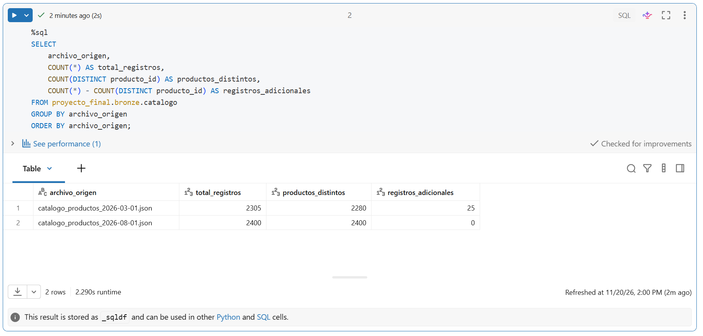

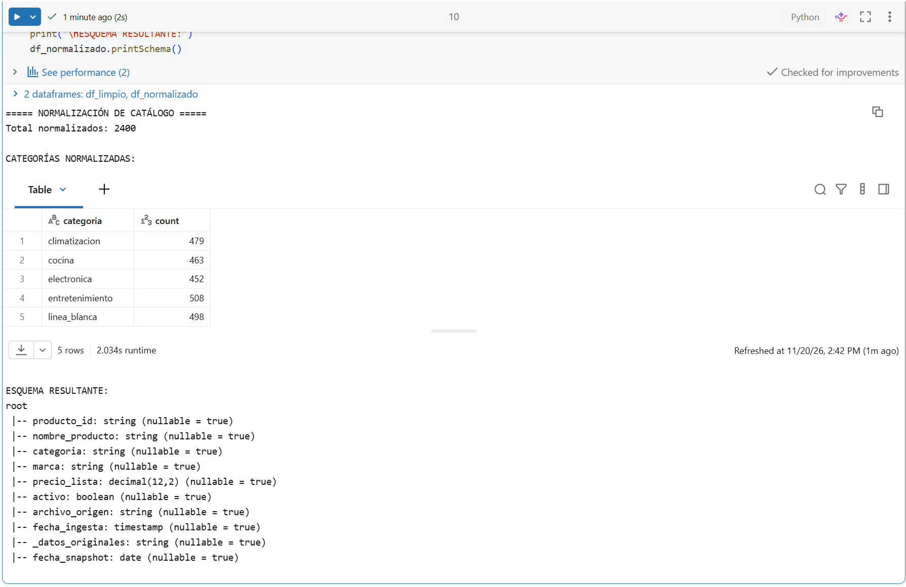

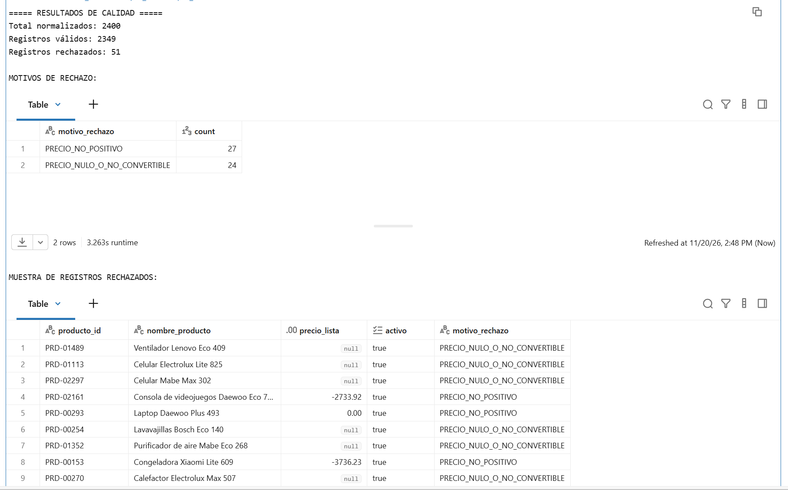

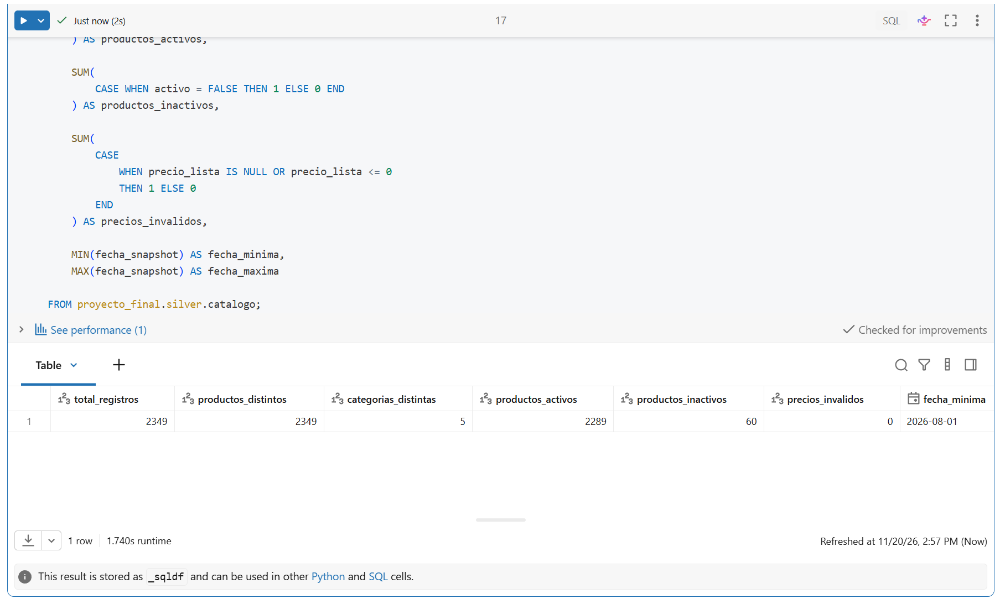

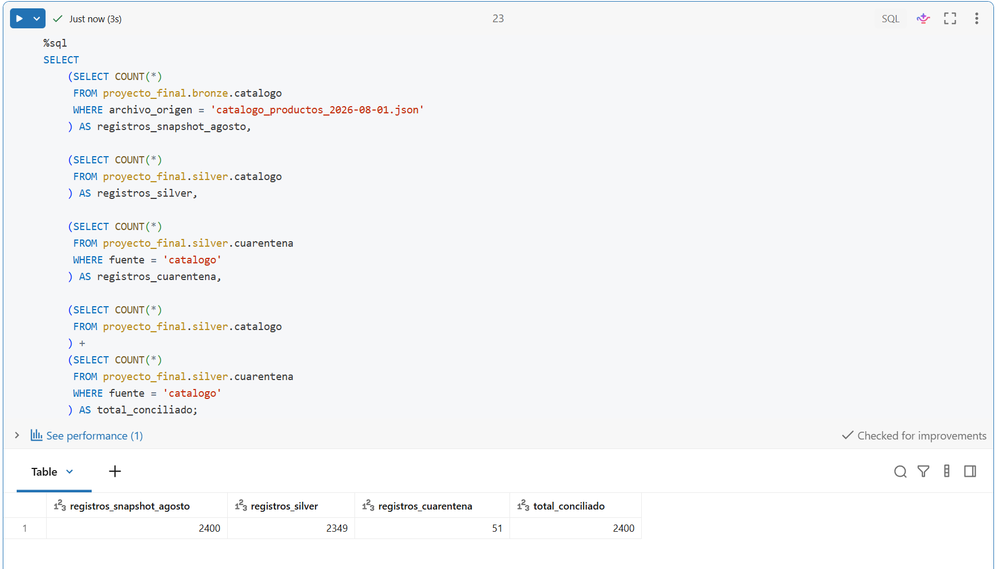

### 5.5 Empleados: dimensión histórica SCD Tipo 2 y protección sensible

El notebook `10_silver_empleados` trabaja sobre eventos de alta, transferencia, cambio salarial y baja/cese recibidos en diferentes lotes; normaliza atributos, fechas, salarios y nombres de eventos. Para ordenar correctamente los cambios se utilizan los **campos del origen**: `fecha_evento`, `fecha_registro` y un criterio adicional de archivo, sin sustituir el orden de negocio por `current_timestamp()`. Se comprueban los eventos del mismo día y las llegadas tardías.

Un hallazgo determinante fueron **36 empleados con historial no fiable por alta inicial rechazada**: el notebook bloquea su historial completo (107 eventos relacionados) en vez de generar versiones desde un estado laboral desconocido. Otros problemas de calidad, como fechas no válidas, salarios fuera de regla o DNI vacío, también se clasifican. Los motivos se conservan en `motivo_rechazo_final` y en `silver.cuarentena`.

Para construir SCD2, tras verificar que no hay secuencias inválidas, el código selecciona el último evento del empleado en cada día por `fecha_registro`, ordena los días cronológicamente y construye intervalos `[vigente_desde, vigente_hasta)` mediante `LEAD()`. Calcula `version`, `es_actual` y `activo` y valida ausencia de solapamientos, discontinuidades y más de una versión actual por empleado. Esta granularidad diaria es relevante para las preguntas Gold de plantilla por mes y sucursal histórica de vendedor.

**Resultados documentados:** 4 231 versiones históricas; 1 460 empleados distintos; 1 109 empleados activos actuales; **181 eventos en cuarentena**. Los conteos de eventos Bronze y de versiones SCD2 **no deben sumarse como si fueran una misma granularidad**: el notebook consolida eventos del mismo día en una versión.

En el mismo notebook se crean funciones SQL `proyecto_final.silver.mask_dni` y `proyecto_final.silver.mask_salario`. El `CREATE TABLE ... MASK` aplica esas funciones a `dni` y `salario`: los miembros de `electrocasa_ingenieria` pueden consultar el valor original por `is_account_group_member(...)`; para otros usuarios DNI se presenta como `********` y salario como `NULL`. La declaración de las máscaras **está en el código**, pero la demostración efectiva con usuarios o grupos diferentes y el tratamiento en un pipeline declarativo se documentarán posteriormente junto con gobierno y seguridad.

**Evidencias:**

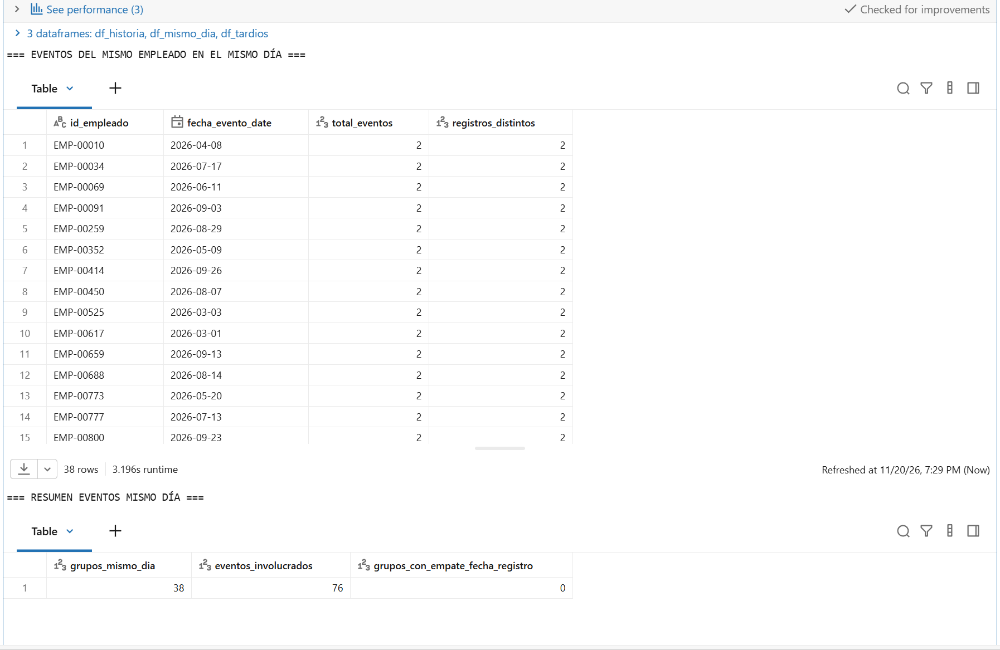

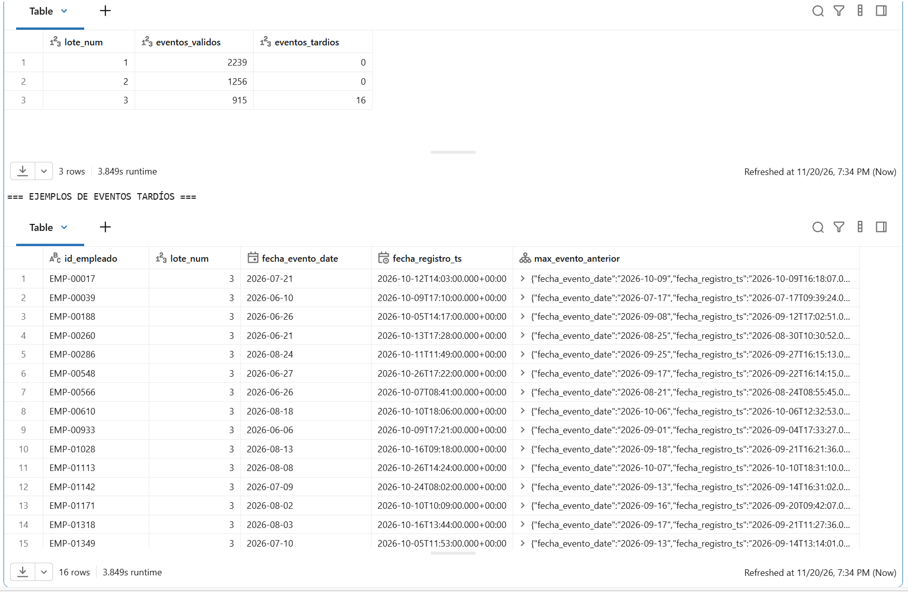

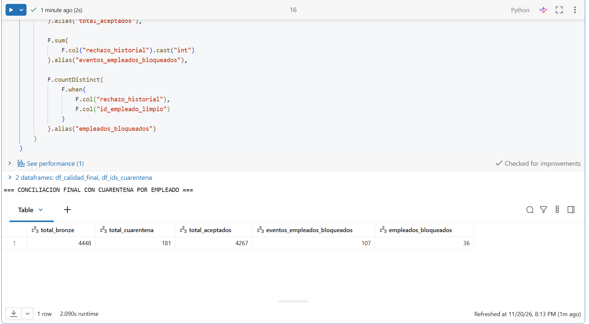

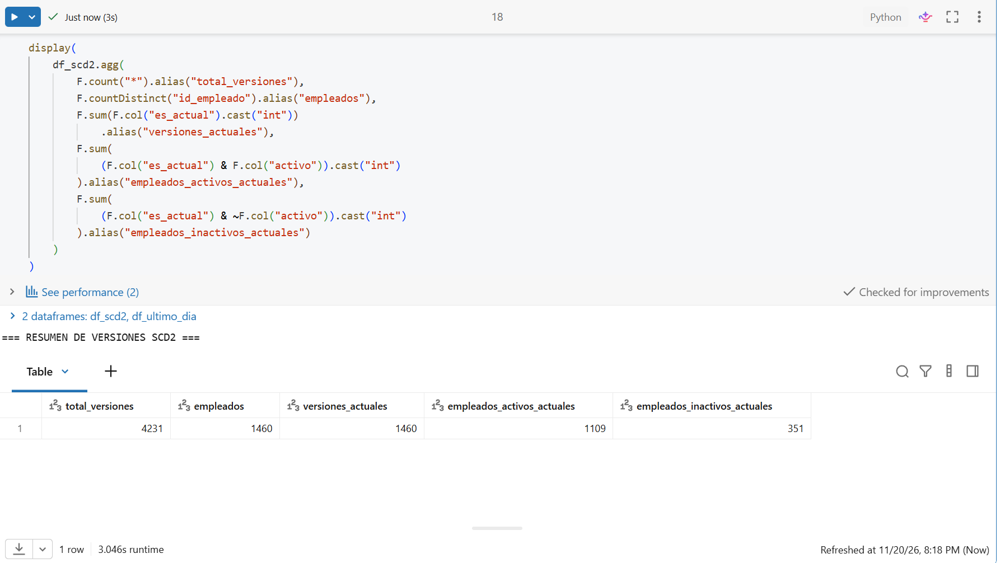

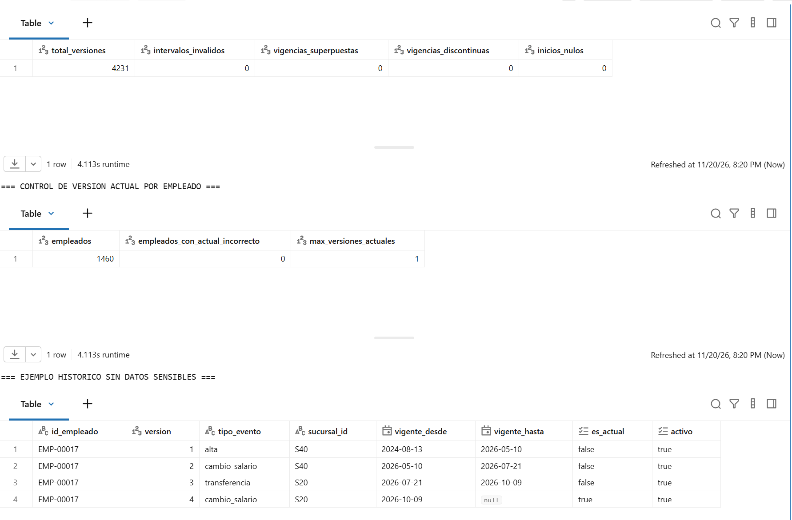

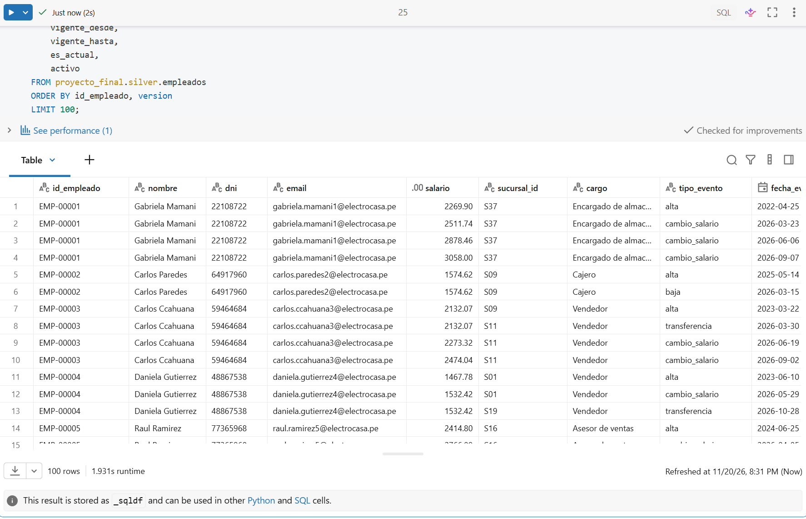

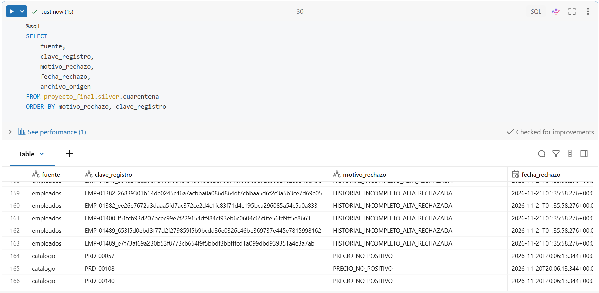

### 5.6 Reseñas: JSON anidado y controles de calidad

El notebook `11_silver_resenas` trabaja con JSON Lines y mantiene las estructuras útiles para el análisis: `tags` como arreglo de textos, `respuestas` como arreglo de estructuras (autor, texto y fecha) y `metadata` en su representación JSON. Normaliza las fechas, valida `calificacion` entre **1 y 5**, verifica la existencia del producto contra el catálogo y clasifica como inválidas las respuestas de soporte que carezcan de `autor`. Las reseñas duplicadas se deduplican por llave de reseña. La lógica evita eliminar una reseña válida únicamente porque su producto ya no esté en el último snapshot, si existe en snapshots previos del Bronze; esa categoría histórica se resolverá en Gold.

**Conciliación documentada:** 9 280 registros Bronze; 80 filas duplicadas excedentes; **8 977 reseñas Silver**; **223 reseñas en cuarentena**. Los rechazos incluyen 103 calificaciones inválidas, 112 referencias huérfanas y 8 respuestas sin autor; las categorías de error observadas se registran por registro según las validaciones del notebook. El texto de la reseña no se descarta por comodidad de agregación.

**Evidencias:**

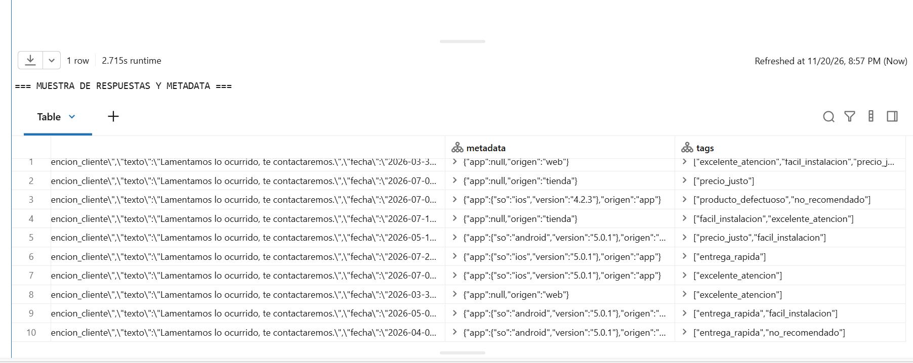

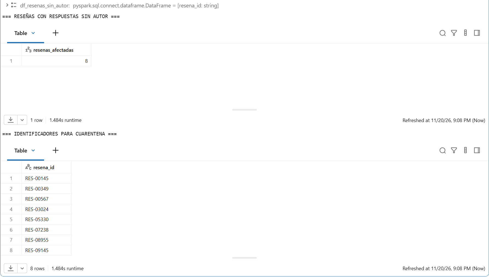

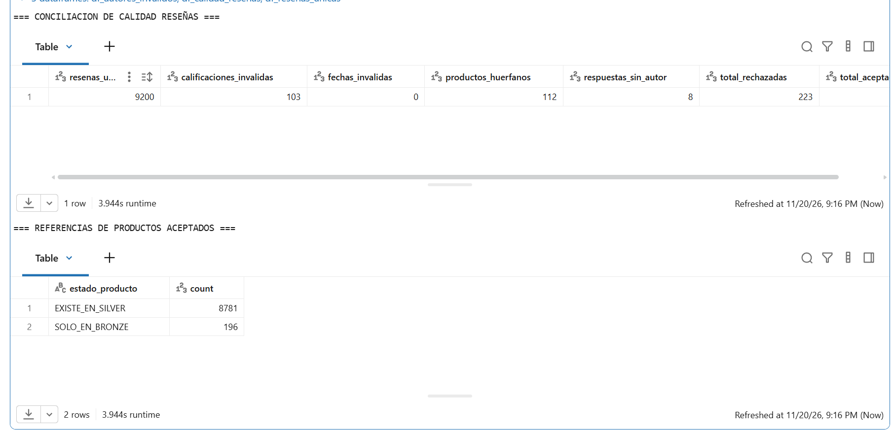

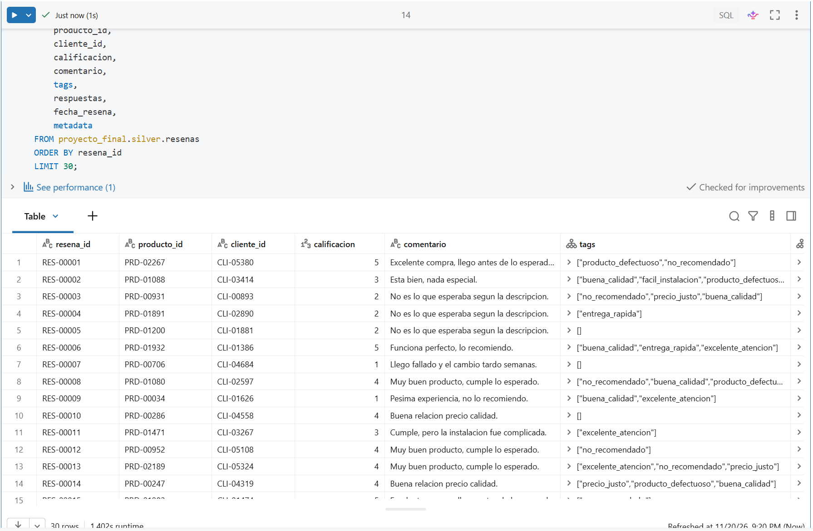

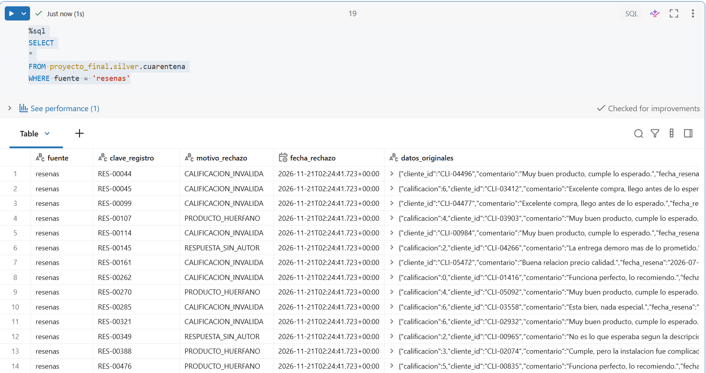

### 5.7 Ventas: importes, canales y referencias

El notebook `12_silver_ventas` parte de tres archivos CSV, conserva el identificador `venta_id`, convierte `monto_total` desde formatos como `1.234,50` y `1234.50` a `DECIMAL(12,2)`, convierte `cantidad` a entero y estandariza las fechas. Mapea **17 escrituras de medio de pago** a `tarjeta`, `efectivo`, `transferencia`, `yape` y `plin`; mantiene los canales `tienda_fisica` y `ecommerce`. El `vendedor_id` **puede ser nulo en ecommerce**, sin invalidar la venta.

Deduplica por `venta_id` usando el orden de ingesta y archivo; verifica sucursales y que cada producto exista en los catálogos considerados, además de importes y cantidades positivos. Las referencias huérfanas o filas críticas se envían a cuarentena con motivos explícitos como `MONTO_INVALIDO`, `CANTIDAD_INVALIDA`, `SUCURSAL_INVALIDA` y `PRODUCTO_HUERFANO` (pueden coexistir en un mismo registro).

**Conciliación:** 18 240 filas Bronze, **240 duplicados excedentes**, 17 420 ventas Silver y 580 rechazos únicos; `18 240 = 240 + 17 420 + 580`. Se aceptaron 5 184 ventas ecommerce y 12 236 de tienda física. La validación incluye ausencia de montos nulos/cantidades inválidas y unicidad de `venta_id`.

**Evidencias:**

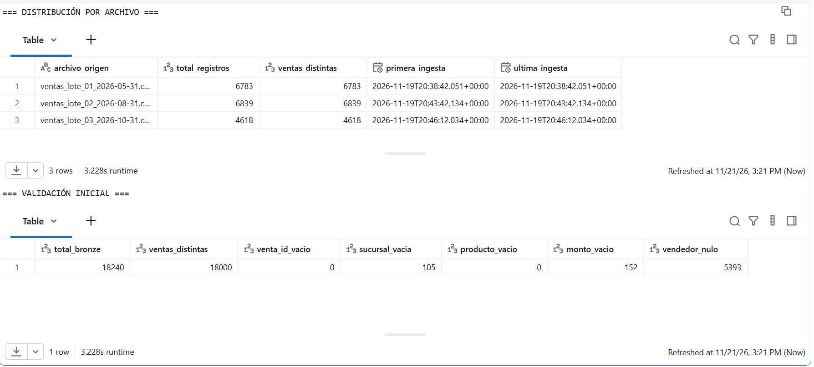

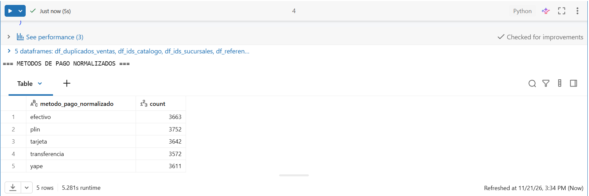

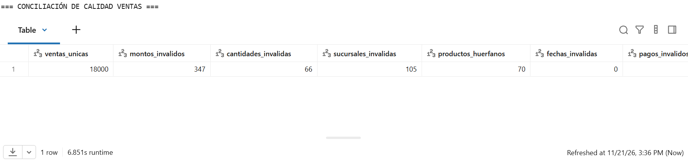

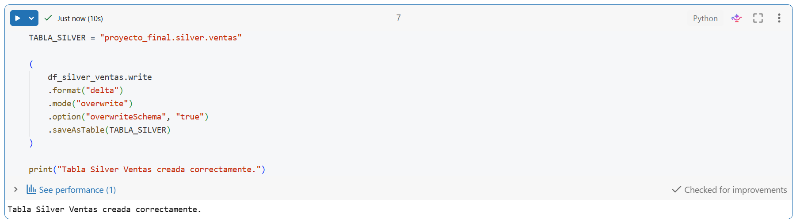

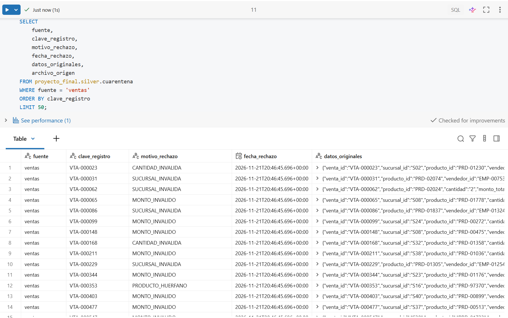

### 5.8 Devoluciones: integridad referencial y reembolsos

El notebook `13_silver_devoluciones` lee los tres lotes Bronze, convierte `monto_reembolso` a `DECIMAL(12,2)` y `fecha_devolucion` a `DATE`, deduplica por `devolucion_id` y realiza un `LEFT JOIN` con `silver.ventas`. La validación se efectúa **después del join**, pues requiere comparar el reembolso con `monto_total` de la venta de origen y verificar referencias de sucursal y producto. La ausencia de `motivo` no produce rechazo: se permite el valor nulo.

Las devoluciones se envían a cuarentena por venta huérfana, reembolso negativo/no convertible, reembolso que excede el valor de la venta, fecha inválida o referencias incompatibles. El notebook también evalúa los reembolsos acumulados por venta, para prevenir sumar devoluciones que excedan el importe original; no se detectaron varias devoluciones válidas para una misma venta en el resultado final.

**Conciliación:** 4 217 registros Bronze; 60 filas duplicadas excedentes; **3 892 devoluciones Silver** y **265 rechazadas**. `4 217 = 60 + 3 892 + 265`. Entre las 4 157 devoluciones distintas se identificaron 200 referencias a ventas no presentes en Silver, 38 reembolsos negativos y 29 excesivos (hay solapamiento entre causas); 71 motivos vacíos se aceptan cuando cumplen las demás reglas.

**Evidencias:**

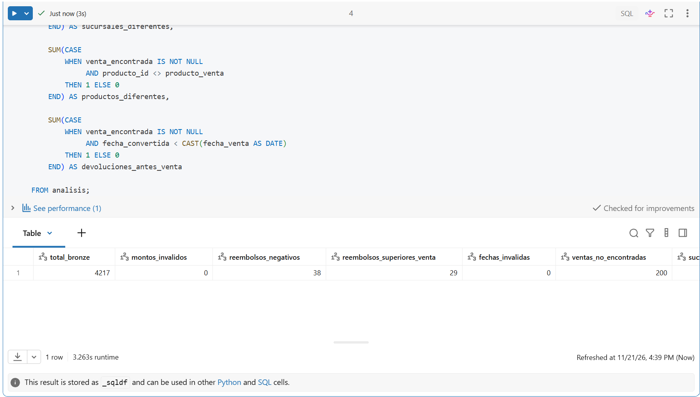


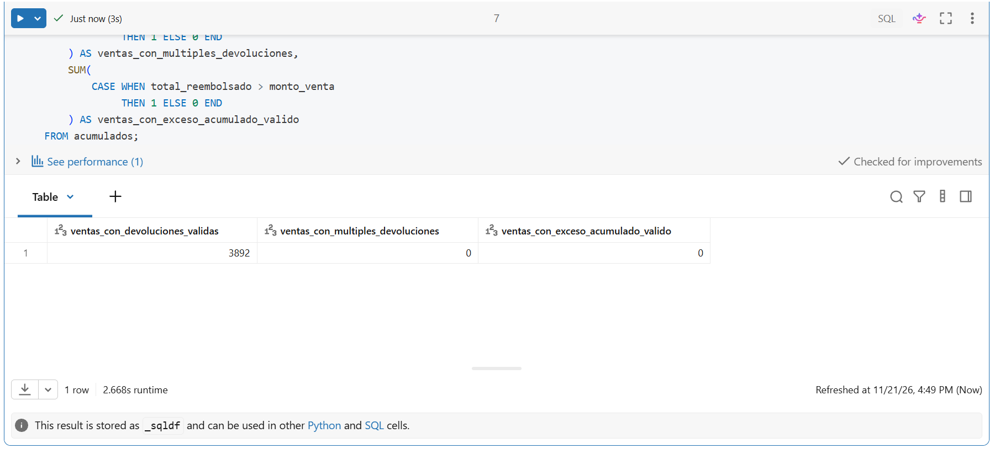

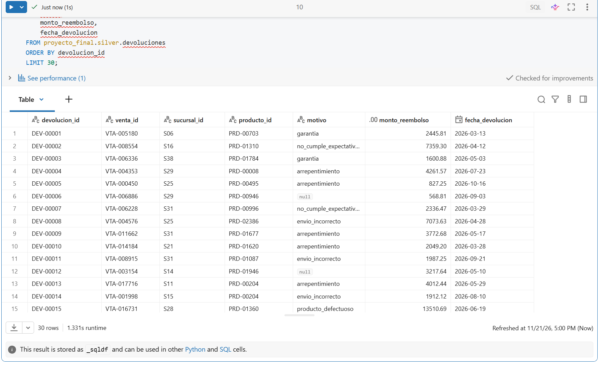

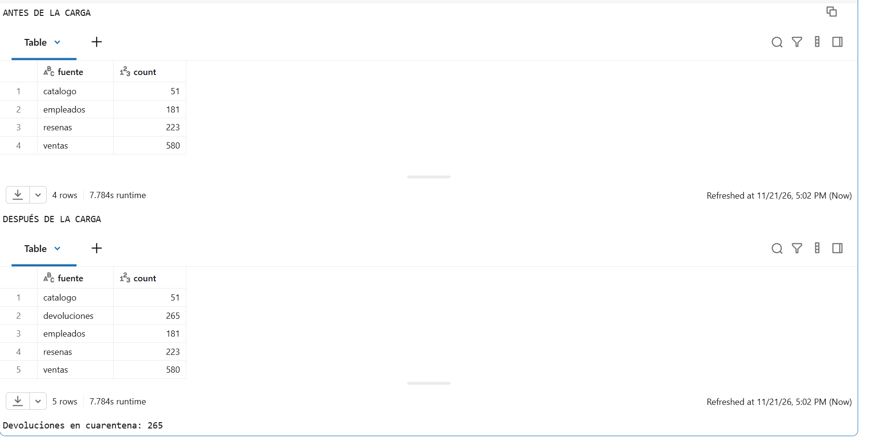

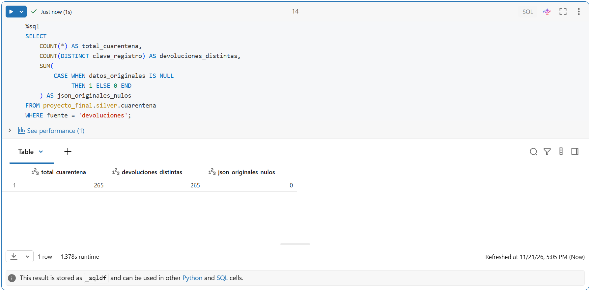

### 5.9 Tracking de envíos: historia de eventos de Azure SQL

La ingesta Bronze procede de Azure SQL Database (`dbo.TrackingEnvios`) mediante el conector Lakeflow Connect; la **primera y segunda ejecución y sus evidencias** ya se describen en la sección **4.8**. Silver no reemplaza el historial por una fila por envío: conserva eventos identificados por `evento_id` y deduplica, si aparecieran reprocesamientos, por `(tracking_id, estado_entrega normalizado, fecha_modificacion)` con el menor identificador. En el conjunto validado se encontraron **0 eventos reprocesados**.

El notebook `14_silver_tracking_envios` normaliza **13 variantes originales de estado** a `pendiente`, `en_transito`, `entregado`, `devuelto`, y **10 variantes de nombre de courier** a `Servientrega`, `Shalom` y `Olva`. Cada evento debe tener identificador, `tracking_id`, fecha de modificación, estado reconocido y una venta existente en `silver.ventas`. Se conservan los eventos válidos de envíos parcialmente inconsistentes y se envían los relacionados con ventas huérfanas a cuarentena.

**Conciliación:** **15 139** eventos Bronze; **14 663** eventos Silver (5 184 envíos distintos); **476** eventos huérfanos en cuarentena. `15 139 = 14 663 + 476`. Los análisis previos identificaron 69 envíos con múltiples ventas asociadas en Bronze, pero **0 con más de una venta válida**; 63 envíos tienen mezcla de eventos válidos y huérfanos, y 148 envíos solo eventos huérfanos.

Para Gold se documentan **4 000 envíos** con marcas suficientes para medir el intervalo entre el primer `pendiente` y el primer `entregado`; hay **18 entregas sin `pendiente`**, todas ellas en envíos mixtos, cuyos tiempos **no se inventan**. En 5 332 envíos Bronze, la normalización demostró un solo courier consistente por envío. En el modelo Gold implementado, la tasa de devolución se define mediante el **último estado cronológico**: envíos cuyo estado actual final es `devuelto` entre envíos cuyo último estado es `entregado` o `devuelto`. Esta definición no debe confundirse con una tasa histórica de envíos que estuvieron alguna vez en estado `devuelto`.

**Evidencias:**

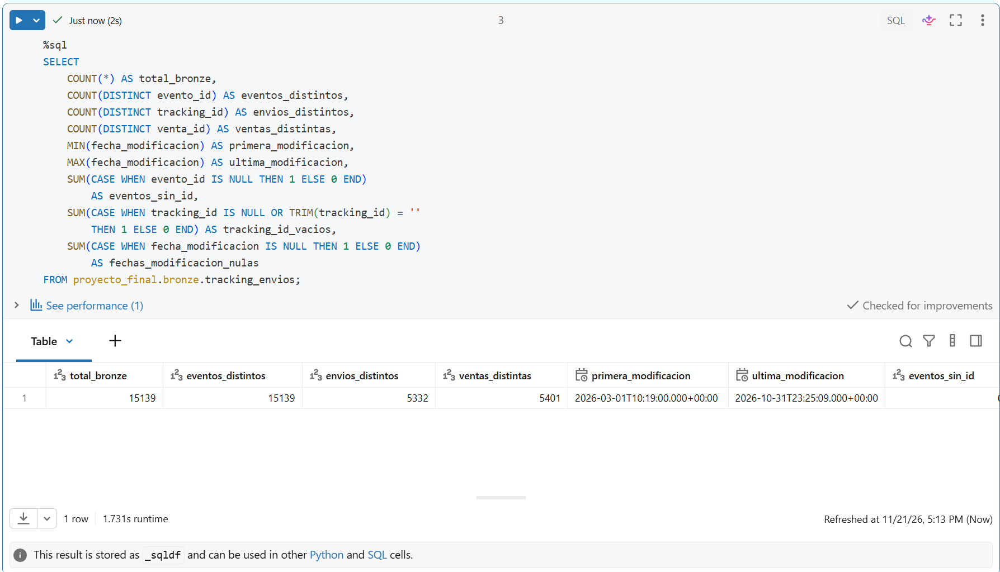


### 5.10 Conciliaciones, trazabilidad y consultas de comprobación

La siguiente tabla recoge los conteos finales sustentados con los notebooks y las evidencias disponibles, distinguiendo registros Bronze, duplicados de negocio, filas Silver y rechazos. **No se suman versiones SCD2 con eventos Bronze**, porque son granularidades diferentes. En Catálogo solo se procesa en Silver el snapshot más reciente, no todos los snapshots históricos.

| Fuente | Bronze / universo de entrada | Eliminación de duplicados | Salida Silver | Cuarentena |
|---|---|---|---|---|
| Sucursales | Referencial de 40 sucursales | Control por `sucursal_id` | 1 fila por sucursal aceptada | 0 en el control final |
| Catálogo | Último snapshot: 2 400 filas | Deduplicación por `producto_id` | 2 349 productos | 51 |
| Empleados | Eventos laborales multilote | Consolidación diaria de eventos SCD2 | 4 231 versiones / 1 460 empleados | 181 |
| Reseñas | 9 280 | 80 duplicados excedentes | 8 977 | 223 |
| Ventas | 18 240 | 240 duplicados excedentes | 17 420 | 580 |
| Devoluciones | 4 217 | 60 duplicados excedentes | 3 892 | 265 |
| Tracking | 15 139 | 0 eventos reprocesados | 14 663 eventos | 476 |

Para verificar las tablas existentes:

```sql
SELECT 'ventas' fuente, COUNT(*) total FROM proyecto_final.silver.ventas
UNION ALL SELECT 'devoluciones', COUNT(*) FROM proyecto_final.silver.devoluciones
UNION ALL SELECT 'resenas', COUNT(*) FROM proyecto_final.silver.resenas
UNION ALL SELECT 'catalogo', COUNT(*) FROM proyecto_final.silver.catalogo
UNION ALL SELECT 'sucursales', COUNT(*) FROM proyecto_final.silver.sucursales
UNION ALL SELECT 'empleados_versiones', COUNT(*) FROM proyecto_final.silver.empleados
UNION ALL SELECT 'tracking_eventos', COUNT(*) FROM proyecto_final.silver.tracking_envios;
```

Para auditar rechazos sin reproducir contenido personal en el README:

```sql
SELECT fuente, motivo_rechazo, COUNT(*) AS registros
FROM proyecto_final.silver.cuarentena
GROUP BY fuente, motivo_rechazo
ORDER BY fuente, registros DESC;
```

**Controles aún por automatizar:** expectativas declarativas (`dp.expect` o `CONSTRAINT ... EXPECT`), orquestación del job, validación por lote desde el job y verificación de masking con identidades de distintos grupos. Estos requisitos no se consideran satisfechos por las ejecuciones manuales documentadas aquí.

### 5.11 Referencias y criterios de evidencia

- **Código reproducible:** notebooks `08_silver_sucursales` a `14_silver_tracking_envios`.
- **Contratos:** `contratos/sucursales.yml`, `contratos/catalogo.yml`, `contratos/empleados.yml`, `contratos/resenas.yml`, `contratos/ventas.yml`, `contratos/devoluciones.yml` y `contratos/tracking_envios.yml`.
- **Capturas:** `evidencias/silver/<fuente>/`. Las rutas de las imágenes en esta sección son **relativas al directorio raíz del repositorio**, para que GitHub pueda mostrarlas.
- **Seguridad de evidencia:** las capturas elegidas priorizan tablas de control y vistas de auditoría; no se reproducen directamente valores de DNI o salario en el README.
- **Estado de los enlaces:** los nombres fueron contrastados con las listas de archivos mostradas en las capturas del workspace. La comprobación definitiva de que GitHub **renderiza** las imágenes debe hacerse tras subir este `README.md` al repositorio, ya que las imágenes no están adjuntas como archivos individuales en esta sesión.

---

## 6. Capa Gold: modelos analíticos y respuestas a las seis preguntas de negocio

> **Resultado principal:** **las seis preguntas de negocio requeridas están respondidas** con consultas SQL ejecutadas y tablas Delta Gold. El desarrollo consta de **37 celdas** del notebook [`15_gold_modelo_analitico`](notebooks/15_gold_modelo_analitico.ipynb), **10 tablas Gold** y evidencias en [`evidencias/gold/modelo_analitico/`](evidencias/gold/modelo_analitico/). Período de análisis: **marzo a octubre de 2026** (ocho meses).

### 6.1 Diseño del modelo analítico

La capa Gold consume los datos preparados en Silver y los organiza por granularidades apropiadas: una fila por venta, devolución, evento de vendedor, versión mensual de empleado, producto, sucursal-mes, categoría-mes o envío, según el objetivo. Se utiliza también el historial de **Bronze Catálogo** para reconstruir la última categoría disponible por producto, sin limitar las reseñas a los productos aceptados en el snapshot Silver más reciente.

**Inventario verificado con la celda 37:**

| Tabla (`proyecto_final.gold`) | Granularidad / función | Filas verificadas |
|---|---|---:|
| `fact_ventas` | Una fila por venta válida, ambos canales | 17 420 |
| `fact_devoluciones` | Una fila por devolución relacionada con venta válida | 3 892 |
| `ventas_netas_mensuales` | Una fila por sucursal y mes | 320 |
| `productos_metricas` | Una fila por producto vendido | 2 390 |
| `fact_empleados_mes` | Una fila por empleado activo en cada cierre mensual | 8 765 |
| `dotacion_mensual` | Una fila por sucursal y mes | 320 |
| `fact_ventas_vendedor` | Una fila por venta presencial, con sucursal histórica | 12 236 |
| `dim_productos` | Una fila por producto del último snapshot conocido | 2 400 |
| `resenas_negativas_mensuales` | Una fila por categoría normalizada y mes | 40 |
| `fact_envios` | Una fila por `tracking_id`, con historia consolidada | 5 184 |


### 6.2 Matriz de trazabilidad: las seis preguntas efectivamente respondidas

| Pregunta requerida | Modelo Gold y celdas de respuesta | Resultado probado |
|---|---|---|
| **1. Ventas netas por sucursal y mes** | `ventas_netas_mensuales`; celda **08** | **320 sucursal-mes**; ventas netas **S/ 62 320 971,42** |
| **2. Top 10 productos por unidades y por tasa de devolución** | `productos_metricas`; celdas **11 y 12** | **Dos rankings Top 10**, calculados sobre **2 390 productos vendidos** |
| **3. Dotación de empleados activos por sucursal al cierre de mes** | `fact_empleados_mes`, `dotacion_mensual`; celda **16** | **320 sucursal-mes**, conciliación con SCD2 sin diferencias |
| **4. Ventas por vendedor y sucursal histórica, solo tienda física** | `fact_ventas_vendedor`; celda **20** | **12 236 ventas**; **308** sin asignación histórica, sin inventar sucursal |
| **5. Porcentaje de reseñas negativas por categoría y mes** | `dim_productos`, `resenas_negativas_mensuales`; celda final **32** | **40 categoría-mes**; **17,37 %** negativas globalmente |
| **6. Horas entre `pendiente` y `entregado` y porcentaje de envíos devueltos** | `fact_envios`; celdas **35 y 36** | **103,20 horas** promedio; **6,45 %** de envíos devueltos |

Las secciones siguientes explican **cómo** se obtiene cada resultado, sus supuestos, controles de calidad y evidencia de ejecución.

### 6.3 Pregunta 1 — ¿Cuáles fueron las ventas netas por sucursal y mes?

**Respuesta: 40 sucursales × ocho meses = 320 filas de análisis.** Se suman ventas brutas de `tienda_fisica` y `ecommerce` en el **mes de venta** y se descuentan los reembolsos en el **mes de devolución**. Se unen ambos agregados por `sucursal_id` y período, manteniendo también combinaciones que existan solo en uno de los dos conjuntos mediante `FULL OUTER JOIN`. El ticket promedio se calcula a partir de las ventas brutas divididas por la cantidad de ventas, no sobre el saldo neto.

| Métrica validada | Valor |
|---|---:|
| Ventas registradas | 17 420 |
| Devoluciones registradas | 3 892 |
| Ventas brutas | S/ 77 449 986,29 |
| Reembolsos | S/ 15 129 014,87 |
| **Ventas netas** | **S/ 62 320 971,42** |
| Sucursales / meses | 40 / 8 |
| Registros descuadrados (`netas ≠ brutas − devoluciones`) | **0** |

**Consulta de respuesta — celda 08 del notebook:**

```sql
SELECT g.periodo, g.sucursal_id, s.nombre_sucursal, s.ciudad,
       g.cantidad_ventas, g.cantidad_devoluciones,
       g.ventas_brutas, g.total_devoluciones,
       g.ventas_netas, g.ticket_promedio
FROM proyecto_final.gold.ventas_netas_mensuales g
LEFT JOIN proyecto_final.silver.sucursales s
  ON g.sucursal_id = s.sucursal_id
ORDER BY g.periodo, g.ventas_netas DESC, g.sucursal_id
LIMIT 50;
```

**Evidencias de creación, conciliación y respuesta:**


### 6.4 Pregunta 2 — ¿Cuáles son los diez productos más vendidos y los diez con mayor tasa de devolución?

**Respuesta: se presentan dos rankings independientes de diez productos cada uno.** `productos_metricas` resume, por producto, unidades vendidas (`SUM(cantidad)`), cantidad de ventas (`COUNT(DISTINCT venta_id)`), importe de ventas, cantidad de devoluciones (`COUNT(DISTINCT devolucion_id)`) y monto reembolsado.

La tasa de devolución se define **por operaciones**, no por unidades:

```text
tasa_devolucion_pct = 100 × cantidad_devoluciones / cantidad_ventas
```

Sobre **2 390 productos vendidos** se verificaron **17 420 ventas, 24 884 unidades y 3 892 devoluciones**, sin tasas fuera de 0–100 %. El líder del ranking por unidades es **PRD-02306 (30 unidades, 16 ventas)**. El ranking por mayor tasa contiene productos con **100 % de devolución**, por ejemplo **PRD-01152** con cinco ventas y cinco devoluciones; una tasa alta con pocos casos debe interpretarse con el volumen de operaciones a la vista.

**Consultas de respuesta — celdas 11 y 12:**

```sql
-- Top 10 por unidades vendidas
SELECT producto_id, unidades_vendidas, cantidad_ventas,
       monto_vendido, cantidad_devoluciones, tasa_devolucion_pct
FROM proyecto_final.gold.productos_metricas
ORDER BY unidades_vendidas DESC, cantidad_ventas DESC, producto_id
LIMIT 10;

-- Top 10 por tasa de devolución
SELECT producto_id, cantidad_ventas, cantidad_devoluciones,
       unidades_vendidas, tasa_devolucion_pct, monto_reembolsado
FROM proyecto_final.gold.productos_metricas
ORDER BY tasa_devolucion_pct DESC,
         cantidad_devoluciones DESC, cantidad_ventas DESC, producto_id
LIMIT 10;
```


### 6.5 Pregunta 3 — ¿Cuántos empleados activos tenía cada sucursal al cierre de cada mes?

**Respuesta: dotación mensual de las 40 sucursales para cada uno de los ocho cierres de marzo–octubre.** No se utiliza únicamente el estado actual del empleado; se consulta el **historial SCD Tipo 2** de `silver.empleados`. Una versión se considera vigente al cierre cuando `vigente_desde <= fecha_cierre`, `vigente_hasta IS NULL OR vigente_hasta > fecha_cierre` y `activo = TRUE`. Se consolidan empleados distintos por sucursal. Un `CROSS JOIN` entre meses y sucursales garantiza una fila incluso si una sucursal no tiene empleados activos.

| Cierre 2026 | Empleados activos | Sucursales | Diferencia vs. SCD2 |
|---|---:|---:|---:|
| Marzo | 1 023 | 40 | 0 |
| Abril | 1 060 | 40 | 0 |
| Mayo | 1 068 | 40 | 0 |
| Junio | 1 102 | 40 | 0 |
| Julio | 1 109 | 40 | 0 |
| Agosto | 1 136 | 40 | 0 |
| Septiembre | 1 158 | 40 | 0 |
| Octubre | 1 109 | 40 | 0 |

**Consulta de respuesta — celda 16:**

```sql
SELECT periodo, fecha_cierre, sucursal_id,
       nombre_sucursal, ciudad, empleados_activos
FROM proyecto_final.gold.dotacion_mensual
ORDER BY periodo, empleados_activos DESC, sucursal_id
LIMIT 50;
```

El control de la celda **17** reconcilia cada cierre con el SCD2; **los ocho períodos presentaron diferencia cero y estado `OK`**.


### 6.6 Pregunta 4 — ¿Cuánto vendió cada vendedor en tienda física y en qué sucursal estaba asignado cuando vendió?

**Respuesta: 12 236 ventas físicas, con sucursal histórica determinada por la vigencia SCD2 del empleado al momento de la venta.** Las **5 184 ventas ecommerce** no forman parte de esta pregunta. El notebook busca la versión del vendedor correspondiente a `fecha_venta`; cuando no existe una versión histórica activa aplicable utiliza el identificador explícito **`SIN_ASIGNAR`**, sin atribuir artificialmente la venta a la sucursal actual o al origen de la operación.

| Indicador | Resultado |
|---|---:|
| Ventas físicas / IDs distintos | 12 236 |
| Vendedores distintos | 984 |
| Importe de ventas físicas | S/ 54 727 797,80 |
| Ventas con asignación histórica | 11 928 |
| Ventas sin asignación histórica | **308** |

**Consulta de respuesta — celda 20:**

```sql
SELECT v.periodo, v.vendedor_id,
       v.sucursal_historica AS sucursal_id,
       COALESCE(s.nombre_sucursal, 'SIN_ASIGNAR') AS nombre_sucursal,
       COUNT(DISTINCT v.venta_id) AS cantidad_ventas,
       ROUND(SUM(v.monto_total), 2) AS monto_vendido
FROM proyecto_final.gold.fact_ventas_vendedor v
LEFT JOIN proyecto_final.silver.sucursales s
  ON v.sucursal_historica = s.sucursal_id
GROUP BY v.periodo, v.vendedor_id, v.sucursal_historica, s.nombre_sucursal
ORDER BY v.periodo, monto_vendido DESC, v.vendedor_id
LIMIT 50;
```


### 6.7 Pregunta 5 — ¿Qué porcentaje de reseñas negativas hubo por categoría y mes?

**Respuesta: 40 combinaciones categoría-mes y un 17,37 % de reseñas negativas en conjunto.** Se consideran negativas las calificaciones **1 y 2**; el denominador incluye todas las reseñas aceptadas. La categoría se consulta a partir del **último snapshot disponible de cada producto**, reconstruido desde Bronze Catálogo: **2 400 productos distintos** en la dimensión Gold y **cero reseñas sin categoría**.

Se detectó y corrigió una inconsistencia de escritura: `Linea_blanca`/`Línea blanca` y `Climatizacion`/`Climatización`. La primera agregación produjo siete valores textuales de categoría; la corrección (celdas **29 y 30**) los unificó en **cinco categorías**, sin eliminar reseñas. La **respuesta final y vigente** es la celda **32**, no la consulta exploratoria de la celda 28.

| Métrica final | Valor |
|---|---:|
| Meses / categorías normalizadas | 8 / 5 |
| Registros categoría-mes | **40** |
| Reseñas totales | 8 977 |
| Reseñas negativas (1 o 2) | 1 559 |
| Reseñas no negativas | 7 418 |
| **Porcentaje negativo global** | **17,37 %** |
| Reseñas sin categoría | 0 |

**Consulta de respuesta — celda 32:**

```sql
SELECT periodo, categoria, total_resenas,
       resenas_negativas, resenas_no_negativas, porcentaje_negativas
FROM proyecto_final.gold.resenas_negativas_mensuales
ORDER BY periodo, porcentaje_negativas DESC, categoria;
```

**Reproducibilidad:** en el notebook entregado, la creación inicial de `dim_productos` (celda 24) no corrige por sí sola todos los valores con guion bajo. Para reproducir el **resultado final validado**, las celdas deben ejecutarse secuencialmente, **incluidas las celdas 29 y 30**. Al transformar el notebook en un pipeline se deberá integrar la normalización en la construcción de la dimensión, antes de crear los agregados, para evitar escrituras y consultas intermedias con categorías sin consolidar.


### 6.8 Pregunta 6 — ¿Cuánto tardan los envíos y qué porcentaje termina devuelto?

**Respuesta: 103,20 horas promedio de entrega, equivalentes a aproximadamente 4,30 días; 6,45 % de los envíos con estado final quedaron devueltos.** `gold.fact_envios` consolida los **14 663 eventos Silver** en **5 184 `tracking_id` únicos**. Para cada envío toma el primer evento `pendiente`, el primer `entregado` y el último evento cronológico (desempate por `evento_id`). El tiempo se mide desde el primer `pendiente` hasta el primer `entregado`, únicamente en envíos cuyo **último estado es `entregado`** y cuyo intervalo es válido.

La tasa utilizada en la consulta implementada es:

```text
porcentaje_envios_devueltos =
  100 × envíos cuyo último estado es 'devuelto'
      / envíos cuyo último estado es 'entregado' o 'devuelto'
```

| Métrica verificada | Valor |
|---|---:|
| Envíos distintos | 5 184 |
| Eventos históricos considerados | 14 663 |
| Estado final `entregado` | 4 018 |
| Estado final `devuelto` | 277 |
| Envíos con estado final | **4 295** |
| Entregas con tiempo calculable | 4 000 |
| Entregas sin evento inicial `pendiente` | **18** |
| **Tiempo medio** | **103,20 horas** |
| Tiempo mínimo / máximo | 15,12 / 191,00 horas |
| **Porcentaje de envíos devueltos** | **6,45 %** |
| Tiempos negativos | **0** |

Los 18 envíos sin inicio `pendiente` **no se imputan**: se excluyen del promedio, pero permanecen en el conteo de entregados. Los envíos `pendiente` o `en_transito` **no entran en el denominador de la tasa final**. Los resultados corresponden a estado **final al corte del historial**, no a la proporción que alguna vez tuvo una devolución.

**Consulta de respuesta — celda 35 (versión resumida de los indicadores):**

```sql
SELECT COUNT(*) AS total_envios,
       SUM(CASE WHEN estado_final = 'entregado' THEN 1 ELSE 0 END) AS entregados,
       SUM(CASE WHEN estado_final = 'devuelto' THEN 1 ELSE 0 END) AS devueltos,
       COUNT(horas_entrega) AS entregas_tiempo_calculable,
       ROUND(AVG(horas_entrega), 2) AS horas_promedio,
       CAST(100.0 * SUM(es_devuelto) /
            NULLIF(SUM(tiene_estado_final), 0) AS DECIMAL(10,2))
            AS porcentaje_devueltos
FROM proyecto_final.gold.fact_envios;
```

La celda **36** muestra los envíos individuales con fecha de inicio, fecha de entrega y horas calculadas.


### 6.9 Validaciones cruzadas, límites y reproducibilidad

**Conciliación general de Gold:** 17 420 ventas y 3 892 devoluciones alimentan las preguntas 1 y 2; las 12 236 ventas de canal físico son un subconjunto de `fact_ventas`; los 8 765 registros históricos empleado-mes agregan a 320 combinaciones sucursal-mes; las 8 977 reseñas agregan a 40 combinaciones categoría-mes; los 14 663 eventos de seguimiento se consolidan en 5 184 envíos. Se comprobó además: ninguna diferencia contable en ventas netas, ninguna diferencia mensual frente al SCD2, ningún porcentaje negativo fuera de rango en la validación previa, y ningún tiempo de entrega negativo.

**Consideraciones técnicas:**

1. Las 37 celdas del notebook se ejecutaron de manera manual. La capa Gold **está construida y responde las seis preguntas**, pero todavía **no está automatizada** mediante el pipeline o bundle declarativo del proyecto.
2. Las escrituras `CREATE OR REPLACE TABLE` reconstruyen tablas completas. La futura automatización deberá establecer dependencias Bronze → Silver → Gold y definir la estrategia de actualización e idempotencia.
3. El catálogo histórico de productos se usa para clasificar todas las reseñas; la dimensión Gold de 2 400 productos **no equivale** a los 2 349 productos válidos del snapshot Silver actual.
4. La asignación de vendedores sin vigencia histórica se deja explícitamente en `SIN_ASIGNAR`; las 18 entregas sin evento `pendiente` conservan `horas_entrega = NULL`.
5. La columna `dni` no participa en las respuestas Gold. Las políticas de masking y la prueba de acceso mediante distintos grupos quedan **pendientes de implementación y evidencia**.

**Trazabilidad del desarrollo:** notebook [`15_gold_modelo_analitico.ipynb`](notebooks/15_gold_modelo_analitico.ipynb), celdas **01–37**, con evidencia organizada en `evidencias/gold/modelo_analitico/` y nombres que coinciden con el inventario visual del workspace. La ruta con doble extensión `18_creacion_fact_ventas_vendedor.png.png` **es el nombre observado en el workspace**; no debe simplificarse al enlazar esa imagen hasta renombrar físicamente el archivo.


---

## 7. Despliegue, automatización y seguridad pendiente

Las capas **Bronze, Silver y Gold están implementadas** y sus resultados de negocio están documentados. Para cerrar el entregable operativo quedan por completar y validar: **orquestación de ejecución por dependencias**, expectativas/calidad automatizadas según los requisitos del curso, **política de enmascaramiento del DNI con comprobación efectiva por grupos**, archivos YAML del bundle de despliegue, ejecución de prueba extremo a extremo y documentación definitiva de esos componentes en este README. Estas actividades se distinguen expresamente de las seis preguntas analíticas, que **sí están contestadas y verificadas**.
